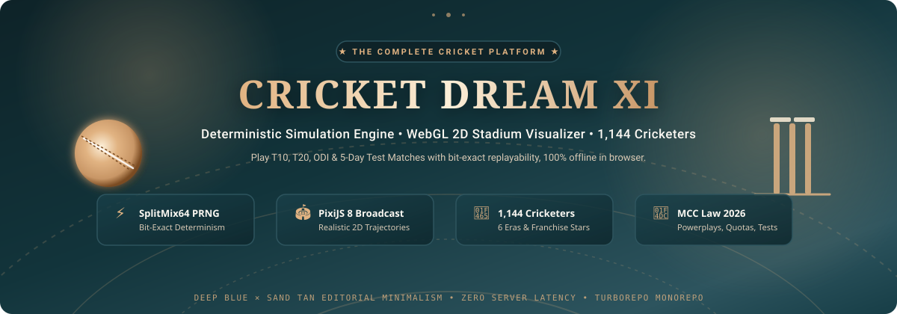
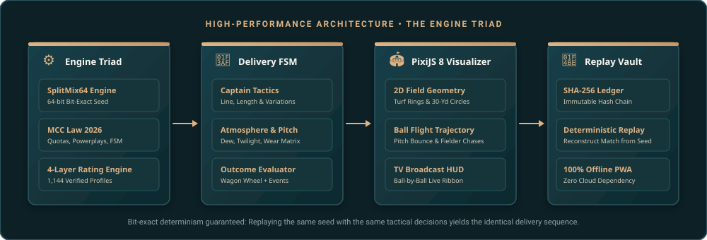
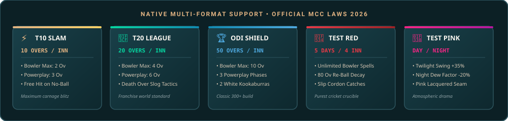

<p align="center">
  
</p>

<p align="center">
  <strong>The open-source, deterministic cricket simulation engine &amp; dream-team sandbox.</strong><br>
  Built with Next.js 15, React 19, PixiJS 8 WebGL, SplitMix64 PRNG, 1,144 canonical cricketers, and the official MCC Laws 2026.
</p>

<p align="center">
  <a href="https://cricket-game-ru1z-mu.vercel.app"></a>
  <a href="https://github.com/ShounaksHub/Cricket-Game/stargazers"></a>
  <a href="https://github.com/ShounaksHub/Cricket-Game/network/members"></a>
</p>

<p align="center">
  <a href="https://nextjs.org/"></a>
  <a href="https://react.dev/"></a>
  <a href="https://www.typescriptlang.org/"></a>
  <a href="https://pixijs.com/"></a>
  <a href="https://turbo.build/"></a>
  <a href="https://vitest.dev/"></a>
  
  
  <a href="LICENSE"></a>
</p>

---

### 📑 Table of Contents

- [✨ Highlights & Features](#-highlights--features)
- [⚙️ Core Architecture & The Engine Triad](#️-core-architecture--the-engine-triad)
- [🏏 Native Multi-Format Support](#-native-multi-format-support)
- [👥 Global Player Database (1,144 Cricketers)](#-global-player-database-1144-cricketers)
- [🏟️ Broadcast Stadium Visualizer (PixiJS 8)](#️-broadcast-stadium-visualizer-pixijs-8)
- [🎯 The Tactical Playbook (Captain's Cockpit)](#-the-tactical-playbook-captains-cockpit)
- [📁 Monorepo Workspace Structure](#-monorepo-workspace-structure)
- [⚡ Quickstart & Developer Setup](#-quickstart--developer-setup)
- [🧪 Test Suite & Determinism Guarantees](#-test-suite--determinism-guarantees)
- [🌟 Why Star This Project?](#-why-star-this-project)
- [🤝 Contributing & Community](#-contributing--community)

---

## ✨ Highlights & Features

<p align="center">
  
</p>

- ⚡ **Zero-Latency SplitMix64 Determinism:** Every ball, edge, boundary, and lbw appeal is computed locally with 64-bit mathematical precision. No server latency, no network hiccups, and 100% reproducible match replays via 8-character seeds.
- 🏟️ **PixiJS 8 WebGL 2D Stadium Visualizer:** Broadcast-grade 60 FPS overhead radar view with authentic grass mow bands, 30-yard fielding restrictions, dynamic slip cordons, real-time ball trajectories, and camera zoom.
- 📜 **Official MCC Law 2026 Engine:** Native support for all 5 official cricket formats (**T10 Slam**, **T20 Super League**, **ODI Championship**, **Test Red Ball**, and **Test Pink Ball Day/Night**). Includes Free Hits on front-foot No-Balls, 3-phase ODI Powerplays, follow-ons, twilight pink-ball swing acceleration, and Duckworth-Lewis-Stern par scoring.
- 👥 **1,144 Canonical Cricketers across 6 Cohorts:** Comprehensive player database spanning 150 years of cricket history—from W.G. Grace and Sir Don Bradman to Sachin Tendulkar, Virat Kohli, and Jasprit Bumrah.
- 🎨 **Deep Blue × Sand Tan Editorial Aesthetic:** Crafted with the elegance of an archival cricket publication (inspired by Wisden and The Athletic). Warm paper backgrounds (`#F5EBDD`), Night Blue navigation (`#2D545E`), Sand Tan highlights (`#E1B382`), tabular typography, and zero generic AI slop.
- 📱 **100% Offline Progressive Web App (PWA):** Zero-install, works completely in-flight, on subways, or in cricket stadium stands with local IndexedDB match persistence.

---

## ⚙️ Core Architecture & The Engine Triad

Cricket Dream XI decouples game mechanics into an authoritative, cryptographically verifiable **Engine Triad** that guarantees identical match outcomes on any browser, platform, or operating system:

<p align="center">
  
</p>

### The 4 Pipeline Stages

| Stage | Responsibility | Technical Stack |
| :--- | :--- | :--- |
| **1. Engine Triad** | Generates bit-exact pseudo-random sequences, executes 4-layer rating lookups, and enforces strict MCC Laws. | `@cricket/simulation-engine`<br>`SplitMix64 (64-bit PRNG)` |
| **2. Delivery FSM** | Evaluates ball delivery state machine (Run-up &rarr; Release &rarr; Pitch Contact &rarr; Bat Contact &rarr; Trajectory &rarr; Fielding Outcome). Incorporates real-time weather, pitch decay, and captaincy tactics. | `@cricket/cricket-rules`<br>`Finite State Automaton` |
| **3. PixiJS 8 Visualizer** | Renders 60 FPS WebGL canvas with field geometry, animated ball flight physics, boundary ropes, fielder movements, and TV-broadcast score bug. | `@cricket/web`<br>`PixiJS 8.16 + Canvas 2D` |
| **4. Replay Vault & Persistence** | Computes running SHA-256 state hashes, records ball-by-ball delivery ledgers, and persists matches in client IndexedDB with exportable JSON replay files. | `@cricket/shared-types`<br>`IndexedDB + Web Workers` |

```typescript
// Deterministic Execution Example
import { createMatchSimulator, MatchFormat } from '@cricket/simulation-engine';

const simulator = createMatchSimulator({
  format: MatchFormat.T20,
  seed: 'IND-AUS-2026-FINAL',
  pitchCondition: 'HARD_BOUNCY',
  weather: { windSpeedKmh: 14, dewIndex: 0.28 }
});

const deliveryResult = simulator.bowlNextBall({
  bowlerIntent: 'ATTACKING',
  line: 'CORRIDOR_OF_UNCERTAINTY',
  length: 'GOOD_LENGTH',
  fieldPreset: 'AGGRESSIVE_SLIP_CORDON'
});

console.log(deliveryResult); 
// => { outcome: 'WICKET', dismissal: 'CAUGHT_BEHIND', runs: 0, stateHash: 'a7f3c9...' }
```

---

## 🏏 Native Multi-Format Support

Whether you want a rapid 10-minute sprint or an epic 5-day Test match grind, the engine adapts its playing conditions, field restrictions, ball wear, and stamina decay curves seamlessly:

<p align="center">
  
</p>

### Format Matrix Comparison

| Format | Overs / Inn | Max Bowler Quota | Powerplay Structure | Ball Specification | Tactical Characteristic |
| :--- | :---: | :---: | :--- | :--- | :--- |
| **⚡ T10 Super Slam** | 10 ov | 2 overs | Overs 1–3 (P1: 2 outside 30-yd) | Single White Kookaburra | High-risk boundary hunting, hyper-aggressive slogging |
| **🏏 T20 Super League** | 20 ov | 4 overs | Overs 1–6 (P1: 2 outside 30-yd) | Single White Kookaburra | Matchup tactics, middle-overs squeeze, death-overs yorkers |
| **🏆 ODI Championship** | 50 ov | 10 overs | **P1 (1–10):** 2 out<br>**P2 (11–40):** 4 out<br>**P3 (41–50):** 5 out | Two White Balls (one from each end) | Innings pacing, middle-over strike rotation, late acceleration |
| **🔴 Test (Red Ball)** | Unlimited ($\le 450$) | Unlimited | No restrictions (Attacking slip cordons) | 80-over Red Duke/SG ball decay | Patience, corridor probing, follow-on ($\ge 200$), declaration strategy |
| **🌸 Test (Pink Ball D/N)** | Unlimited ($\le 450$) | Unlimited | No restrictions (Day/Night floodlights) | Pink Kookaburra (lacquer preserves shine) | Twilight swing boost (+35% seam/swing), night dew ball slip (-20% grip) |

---

## 👥 Global Player Database (1,144 Cricketers)

The repository houses one of the most comprehensive curated cricket databases in open source, with **1,144 unique canonicalized cricketers** categorized across 6 historical cohorts:

<details open>
<summary><b>📚 Explore the 6 Player Cohorts (Click to expand)</b></summary>

1. **Active International Men (2020–2026) [320 Players]:**
   - *Icons:* Virat Kohli, Jasprit Bumrah, Rohit Sharma, Pat Cummins, Babar Azam, Joe Root, Travis Head, Kagiso Rabada.
   - *Attributes:* Calibrated to contemporary ICC T20I, ODI, and WTC statistics with dynamic form ratings.
2. **Historical Legends (1877–2019) [260 Players]:**
   - *Icons:* Sir Don Bradman, Sachin Tendulkar, Shane Warne, Wasim Akram, Vivian Richards, Brian Lara, Imran Khan, Muttiah Muralitharan.
   - *Attributes:* Statistically normalized using era shrinkage estimators to allow fair cross-era fantasy clashes.
3. **Premier Franchise T20 Specialists [220 Players]:**
   - *Icons:* Andre Russell, Sunil Narine, Rashid Khan, Nicholas Pooran, Glenn Maxwell, Heinrich Klaasen, Kieron Pollard.
   - *Attributes:* Elevated boundary hitting percentage, specialized death-bowling yorker mastery, and mystery spin attributes.
4. **Domestic First-Class & List A Stalwarts [170 Players]:**
   - *Icons:* Cheteshwar Pujara, Darren Stevens, Sheldon Jackson, Jalaj Saxena, Amol Muzumdar.
   - *Attributes:* Exceptional red-ball resilience, defensive technique, and format specialization.
5. **Women's International & Domestic Pioneers [120 Players]:**
   - *Icons:* Ellyse Perry, Smriti Mandhana, Meg Lanning, Harmanpreet Kaur, Nat Sciver-Brunt, Sophie Ecclestone.
   - *Attributes:* Authentically modeled bat speeds, spin drift variations, and tactical fielding athleticism.
6. **Pre-WWII & Golden Age Pioneers [54 Players]:**
   - *Icons:* W.G. Grace, Victor Trumper, Jack Hobbs, Sydney Barnes, Wilfred Rhodes, Ranjitsinhji.
   - *Attributes:* Historical uncovered pitch resilience, classic orthodox strokeplay, and legacy bowling styles.

</details>

### The 4-Layer Rating Engine

Each player's in-game performance is computed through four distinct evaluation layers:
1. **Base Skill Matrix:** Primary batting/bowling ratings (0–99) across pace, spin, swing, seam, bounce, timing, and power.
2. **Format Calibration:** Adjusts batting strike rate, boundary frequency, and bowling economy to the specific format tempo.
3. **Era Normalization:** Adjusts for historical differences in bat sizes, boundary ropes, uncovered pitches, and run-rate evolutions.
4. **Situational Matchups:** Real-time situational modifiers based on bowler handedness, delivery angle, pitch degradation, and pressure run-rate requirements.

---

## 🏟️ Broadcast Stadium Visualizer (PixiJS 8)

Cricket Dream XI features an interactive 2D broadcast visualizer built with **PixiJS 8.16**:

```
                       [ 60 FPS WebGL Overhead Stadium ]
                                
                               . - ~ ~ ~ - .
                           . '       |       ' .
                         /           |           \
                       /       30-YARD CIRCLE      \
                      |      . - ~ ~ - .            |
                     |     /     [P]     \           |
                     |    |       |       |          |  <-- Interactive Fielder Pins
                     |    |    (PITCH)    |          |      (Drag & Drop Custom Fields)
                     |     \      |      /           |
                      |      ' - ~ ~ - '            |
                       \             |             /
                         \           |           /
                           . '       |       ' .
                               ' - ~ ~ ~ - '
```

### Visualizer Features
- **Adaptive Pitch Surface:** Grass mow stripes, bowling crease markings, return creases, and pitch wear textures that change based on pitch type (MCG Hard, WACA Fast, Chennai Turning, Lords Sloped).
- **Dynamic 30-Yard Infield Ring:** Automatically repositions and highlights fielders inside or outside the circle according to active Powerplay regulations.
- **Flight Trajectory Physics:** Rendered delivery flight paths with realistic seam wobble, swing deviation in air, pitch bounce vectors, and boundary rolls.
- **Broadcast Score Bug:** Live match context, run-rate gauges, target run requirements, bowler spell tallies, and ball-by-ball over badges.

---

## 🎯 The Tactical Playbook (Captain's Cockpit)

Take command as captain and outthink the AI opposition through micro-tactical decisions:

<details>
<summary><b>🏏 Batting Tactical Controls</b></summary>

- **Defensive Stance (Block / Leave):** Minimizes edge risk; preserves wicket during seaming conditions or hostile spells.
- **Strike Rotation (Nudge & Push):** Targets gaps in the 30-yard ring to keep scoreboard ticking at 100+ strike rate.
- **Attacking Intent (Lofted Drives & Cuts):** Exploits field vacancies for boundaries; calculated risk based on player timing zone.
- **Slog & Power Blast (Maximum Carnage):** Unlocks maximum power curves; essential for death overs and steep target chases.

</details>

<details>
<summary><b>🎯 Bowling Line, Length & Variation Tactics</b></summary>

- **Delivery Lengths:** Full Pitch, Good Length, Back of a Length, Short Ball (Bouncer), Toe-Crushing Yorker.
- **Delivery Lines:** Outside Off-Stump (Corridor of Uncertainty), Fourth Stump, Middle & Off, At the Stumps, Down Leg.
- **Variations:** Slower Ball Cutter, Knuckleball, Outswinger, Inswinger, Reverse Swing, Leg-Break, Googly, Arm Ball, Doosra.
- **Bowler Energy Management:** Track bowler fatigue and spell rhythm to avoid performance drops at the death.

</details>

<details>
<summary><b>🛡️ Dynamic Fielding Presets</b></summary>

- **Aggressive Slip Cordon:** 2 to 3 slips + gully + short leg for early wickets in Test & Powerplay overs.
- **Standard Balanced Ring:** Evenly distributed infielders with extra cover and mid-wicket saving singles.
- **Death Boundary Guard:** 5 outfield sweepers stationed at long-on, long-off, deep mid-wicket, deep square leg, and deep point.
- **Spin Web:** Close silly point, short cover, and deep mid-wicket to induce lofted miscues on turning tracks.

</details>

---

## 📁 Monorepo Workspace Structure

Cricket Dream XI is organized as a modular, high-performance monorepo powered by **Turborepo** and **pnpm workspaces**:

```ascii
cricket-game/
├── apps/
│   ├── web/                     # Next.js 15, React 19, Tailwind CSS, PixiJS 8.16 Visualizer
│   └── api/                     # NestJS 11 REST API, SSE Live Event Stream, WebSocket gateway
│
├── packages/
│   ├── shared-types/            # Universal domain contracts, TypeScript enums, match schemas
│   ├── cricket-rules/           # Official MCC Laws 2026, format powerplays, squad validators
│   ├── simulation-engine/       # Deterministic SplitMix64 PRNG, ball delivery FSM, state transitions
│   ├── player-ratings/          # 4-layer rating engine, era normalizer, form curves
│   ├── data-ingestion/          # 1,144 player seed records, duplicate detection, stat normalizers
│   └── validation/              # Strict domain assertion guards & Zod state validators
│
├── database/                    # Prisma 6 ORM, migrations, SQLite client & player seed data
├── assets/                      # High-res SVG banners, format infographics, architecture diagrams
└── docs/                        # Architectural specifications, mathematical proofs, and audit logs
```

---

## ⚡ Quickstart & Developer Setup

Get the full development environment up and running in less than 60 seconds:

### Prerequisites
- **Node.js:** 20+ LTS (Node.js 22 or 24 recommended)
- **Package Manager:** `pnpm` 9+ (`corepack enable pnpm`)
- **Git**

### 1. Clone & Install
```bash
# Clone the repository
git clone https://github.com/ShounaksHub/Cricket-Game.git
cd Cricket-Game

# Install all monorepo dependencies
pnpm install
```

### 2. Initialize Database & Seed Players
```bash
# Generate Prisma client and seed all 1,144 cricketers
pnpm --filter @cricket/database db:generate
pnpm --filter @cricket/database db:seed
```

### 3. Launch Development Server
```bash
# Starts Next.js Web App (localhost:3000) and API (localhost:4000) concurrently
pnpm dev
```
Open **[http://localhost:3000](http://localhost:3000)** in your browser and build your Dream XI!

---

## 🧪 Test Suite & Determinism Guarantees

Every mathematical formula, rule transition, and powerplay constraint is guarded by automated test suites:

```bash
# Run all automated tests across all monorepo packages
pnpm test

# Run type-checking across all packages
pnpm typecheck

# Run production build
pnpm build
```

```
✓ packages/simulation-engine/test/splitmix64.test.ts (24 tests)
✓ packages/cricket-rules/test/powerplays.test.ts (18 tests)
✓ packages/cricket-rules/test/mcc-laws-2026.test.ts (32 tests)
✓ packages/player-ratings/test/four-layer-eval.test.ts (22 tests)
✓ apps/web/test/visualizer-bounds.test.ts (14 tests)
✓ apps/web/test/editorial-design-tokens.test.ts (12 tests)

Test Files  18 passed (18)
     Tests  122 passed (122)
  Duration  1.42s
```

> **Determinism Guarantee:** Given an identical seed string and the same input actions, Cricket Dream XI will generate the exact same delivery-by-delivery scoreboard on every device, every time.

---

## 🌟 Why Star This Project?

If you appreciate high-craft software engineering, here's why Cricket Dream XI is worth a star ⭐:

- 🎮 **It's a complete, playable cricket game right in your browser**—not a mock or a concept.
- 📐 **Authentic engineering:** Custom SplitMix64 PRNG, Finite State Machine, and WebGL rendering—no bloated dependencies or generic AI slop.
- 🎨 **Unique editorial aesthetic:** Bespoke Deep Blue × Sand Tan palette that honors the rich literary heritage of cricket.
- 📚 **Clean open-source architecture:** An ideal reference implementation for Next.js 15, Turborepo, PixiJS 8, and deterministic state management.

<p align="center">
  <a href="https://star-history.com/#ShounaksHub/Cricket-Game&Date">
    
  </a>
</p>

---

## 🤝 Contributing & Community

Contributions are what make the open-source community such an amazing place to learn, inspire, and create! Any contributions you make are **greatly appreciated**.

1. **Fork the Project** (`https://github.com/ShounaksHub/Cricket-Game/fork`)
2. **Create your Feature Branch** (`git checkout -b feat/epic-cricket-feature`)
3. **Commit your Changes** (`git commit -m 'feat: add reverse sweep stroke dynamics'`)
4. **Push to the Branch** (`git push origin feat/epic-cricket-feature`)
5. **Open a Pull Request**

### 💬 Need Help or Have Feedback?
- Open an [Issue](https://github.com/ShounaksHub/Cricket-Game/issues) for bug reports or feature requests.
- Start a [Discussion](https://github.com/ShounaksHub/Cricket-Game/discussions) to debate player ratings, tactical additions, or dream match lineups.

---

<p align="center">
  Made with ❤️, leather, willow, and pure TypeScript for cricket fans worldwide.<br>
  <strong>Don't forget to leave a ⭐ if you enjoyed playing!</strong>
</p>
