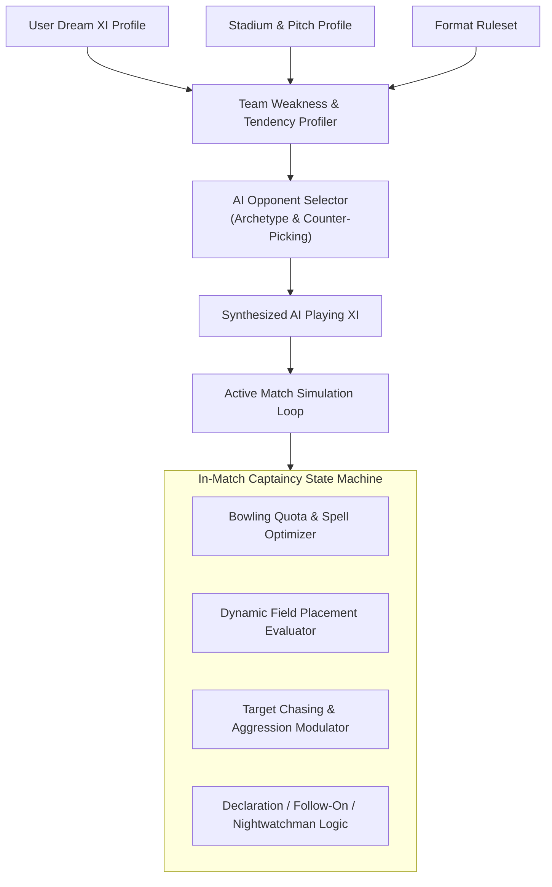
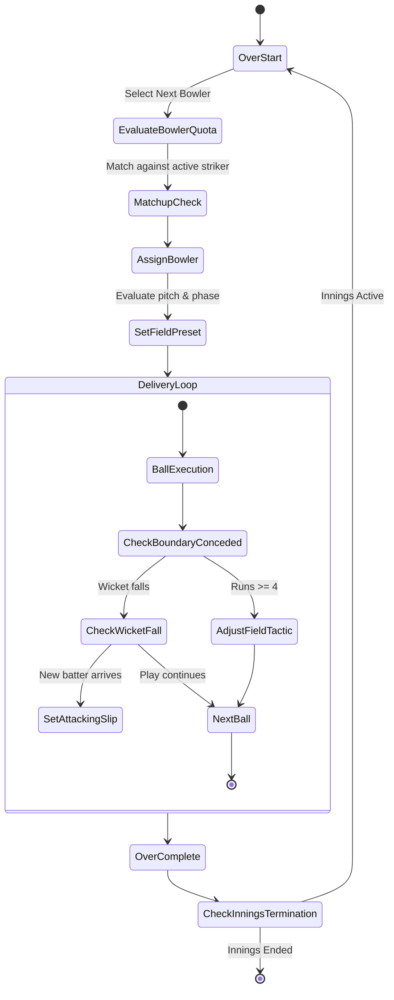

# AI Opponent Generator & Tactical Captaincy Engine

**Document Version:** 1.0.0  
**Status:** DRAFT - AWAITING PHASE 0 REVIEW  
**Packages:** `@cricket/ai-opponent` & `@cricket/ai-captain`  

---

## 1. System Overview & Architecture

The AI system operates on two distinct layers:
1. **Strategic Layer (`@cricket/ai-opponent`):** Pre-match squad intelligence. Analyzes the user's dream XI, stadium dimensions, pitch deterioration characteristics, and match format to generate a formidable, coherent, and counter-tactical XI.
2. **Tactical In-Match Layer (`@cricket/ai-captain`):** Real-time in-match decision making. Governs bowling rotation, field placement shifts, batting aggression adjustments, declarations, and follow-on calls.

---

## 2. Squad Selection & Counter-Picking Heuristics

The AI never picks 11 random high-rated players. It solves a constrained multi-objective optimization problem:

$$\max_{XI \subset \text{PlayerCatalog}} \left[ W_{\text{balance}} \cdot S_{\text{balance}}(XI) + W_{\text{matchup}} \cdot S_{\text{matchup}}(XI, \text{UserXI}) + W_{\text{pitch}} \cdot S_{\text{pitch}}(XI, \text{Pitch}) \right]$$

### Constraints Enforced:
1. Exactly 11 players.
2. Exactly 1 designated Wicketkeeper (`is_wicketkeeper = true` and `wicketkeeping >= 75`).
3. Minimum 5 bowling options capable of fulfilling overs quota (e.g. at least 5 bowlers who can bowl $\ge 4$ overs in T20).
4. Balanced batting lineup: Minimum 6 recognized batters/all-rounders (Batting positions 1–6).
5. At least 1 new-ball strike bowler and 1 death-over bowler.

### Counter-Picking Algorithms:
1. **Handedness Countering:** If the user's top 4 contains $\ge 3$ left-handed batters, the AI prioritizes high-rated off-break spinners and left-arm fast-medium bowlers angling across the batter.
2. **Vulnerability Exploitation:** If the user's middle order exhibits low `Short-Ball Handling` ($< 70$), the AI drafts fast bowlers with high `Bouncer Execution` and `Pace` attributes.
3. **Pitch Exploitation:**
   - *Turning/Dusty Pitch:* Selects twin spinners (e.g., Leg-break + Finger-spin duo).
   - *Green/Overcast Pitch:* Prioritizes swing bowlers with high `New Ball Effectiveness`.
   - *Flat Batting Highway:* Prioritizes deep batting all-rounders and variation-heavy death bowlers.

---

## 3. Strict Simulation Fairness Guarantee

### Non-Negotiable Rule:
**Game difficulty NEVER secretly alters delivery probabilities, boundary edges, catch drop rates, or physics outcomes.**

The transition probability function $P(S_{t+1} \mid S_t, A_{\text{user}}, A_{\text{AI}})$ is completely immutable and invariant across difficulties.

**Difficulty strictly controls the AI's Policy Distribution $\pi_{\text{AI}}(A \mid S)$:**
- Which bowler is chosen for an over.
- How fast the AI detects a batter's weakness and alters field settings.
- Whether the batter selects the optimal risk-to-reward shot in a tight chase.
- Sub-optimal decisions and human-like mistakes injected at lower difficulties.

---

## 4. Difficulty Tier Specifications

### 4.1 EASY Mode
* **Opponent Selection:** Coherent team, but ignores tactical counter-picking. Selects popular players rather than pitch-optimized specialists.
* **Bowling Changes:** Rigid rotation (e.g. Bowler 1 gets overs 1, 3; Bowler 2 gets overs 2, 4). Does not protect expensive bowlers who are conceding high runs.
* **Field Settings:** Static default presets. Fails to adjust field when a batter targets a specific vacant boundary quadrant.
* **Batting Approach:** Linear chasing rate. Does not accelerate when required run rate spikes. 8% probability of selecting an unforced poor shot under pressure.

### 4.2 MEDIUM Mode
* **Opponent Selection:** Balanced squad with standard cricketing logic (e.g. 3 pacers, 1 spinner, 1 all-rounder).
* **Bowling Changes:** Reactive. Replaces bowlers who concede $> 12$ runs in an over. Bowls primary spinner during middle overs.
* **Field Settings:** Switches between `BALANCED` and `BOUNDARY_DEFENSE` based on current over and wickets lost.
* **Batting Approach:** Accelerates if required run rate exceeds current run rate by $> 2.0$. Calibrated risk management.

### 4.3 HARD Mode
* **Opponent Selection:** Ruthless counter-optimization against the user's specific player attributes and pitch profile.
* **Bowling Changes:** Predictive and matchup-driven.
  - Reserves premium death bowlers specifically for overs 18 and 20 in T20.
  - Instantly introduces off-spin when a left-hander takes strike.
  - Pulls bowlers immediately if their line is exploited.
* **Field Settings:** Dynamic custom placements. If the user's batter repeatedly plays the sweep shot, the AI immediately posts deep square leg and backward square leg, closing down scoring avenues.
* **Batting Approach:** High-level match awareness. Targets the user's 5th bowler, rotates strike continuously against strike bowlers, and executes high-percentage boundary options.

---

## 5. In-Match Captaincy State Machine

### 5.1 Test Cricket Captaincy Logic
* **Follow-On Decision:** If the lead $\ge 200$ runs, the AI enforces the follow-on unless its primary bowlers have bowled $\ge 28$ overs each and current fatigue levels exceed 70%.
* **Declaration Logic:** The AI declares when its target lead produces a required run rate for the user exceeding $4.5$ runs/over with less than 75 overs remaining on Day 5, ensuring enough time to bowl the user out.
* **Nightwatchman Deployment:** If a top-order wicket falls with $< 6$ overs remaining before Stumps on Days 1–4, the AI promotes a defensive lower-order bowler (`defensive_ability >= 65`) to protect key batters.
