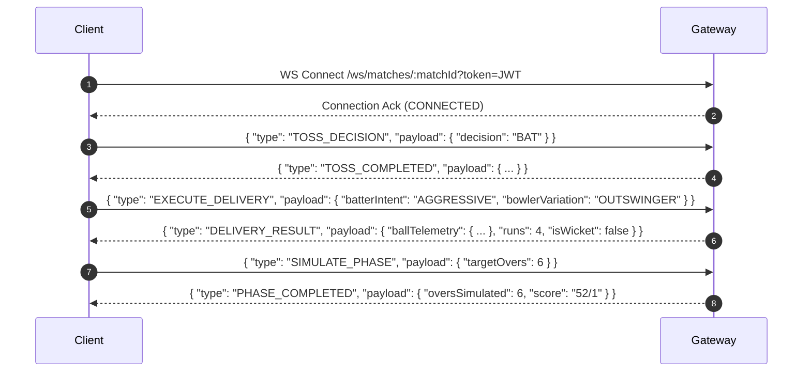

# API Specification & WebSocket Protocol

**Document Version:** 1.0.0  
**Status:** DRAFT - AWAITING PHASE 0 REVIEW  
**Base URL:** `https://api.cricketdream.game/api/v1`  
**WebSocket Gateway:** `wss://api.cricketdream.game/ws/matches`  

---

## 1. RESTful API Endpoints

All responses are formatted in JSON with standardized response envelopes. Error responses follow **RFC 7807 (Problem Details for HTTP APIs)**.

### 1.1 Authentication & User Domain
* `POST /auth/register` - Create account (email, username, password).
* `POST /auth/login` - Authenticate user; returns JWT access token & sets HttpOnly refresh token cookie.
* `POST /auth/refresh` - Refresh expired access token.
* `GET /auth/me` - Retrieve current user profile and preferences.

### 1.2 Player Catalogue & Statistics

#### `GET /players`
Search and filter the global player database with cursor pagination.

**Query Parameters:**
* `search`: String (searches display name, full name, aliases).
* `nationality`: String (country code or name).
* `era`: Enum (`GOLDEN_AGE_PRE_1914`, `INTERWAR_1919_1939`, etc.).
* `role`: Enum (`TOP_ORDER_BATTER`, `PACE_BOWLER`, `SPIN_BOWLER`, etc.).
* `format`: Enum (`T10`, `T20`, `ODI`, `TEST_RED_BALL`, `TEST_PINK_BALL`).
* `minRating`: Integer (0–100).
* `cursor`: UUID string.
* `limit`: Integer (default 20, max 100).

**Response (200 OK):**
```json
{
  "data": [
    {
      "id": "e8b1c7a2-9b2f-4e12-8e2b-1a2c3d4e5f6a",
      "displayName": "V. Kohli",
      "fullName": "Virat Kohli",
      "primaryNationality": "India",
      "primaryRole": "TOP_ORDER_BATTER",
      "battingHand": "RIGHT_HAND",
      "bowlingStyle": "RIGHT_ARM_MEDIUM",
      "isWicketkeeper": false,
      "historicalEra": "CONTEMPORARY_2021_PRESENT",
      "ratings": {
        "format": "T20",
        "overallRating": 93,
        "battingRating": 95,
        "bowlingRating": 25,
        "fieldingRating": 88,
        "confidenceTier": "MEASURED"
      },
      "avatarUrl": "https://assets.cricketdream.game/photos/v_kohli_thumb.webp"
    }
  ],
  "pagination": {
    "nextCursor": "f9c2d8b3-0c3a-5f23-9f3c-2b3d4e5f6a7b",
    "hasMore": true
  }
}
```

* `GET /players/:id` - Detailed player profile, bio, confidence scores, and historical data provenance.
* `GET /players/:id/stats` - Comprehensive statistics breakdown across all five formats.
* `GET /players/:id/attributes` - Granular 5-category attribute scores (0–100).

### 1.3 Dream Team Domain

#### `POST /teams`
Create a new Dream Team.

**Request Body:**
```json
{
  "teamName": "All-Time Subcontinent Masters",
  "format": "T20",
  "badgeIcon": "SHIELD_GOLD",
  "primaryColor": "#0D4A38",
  "secondaryColor": "#D4AF37",
  "lineup": [
    { "playerId": "uuid-1", "battingOrder": 1, "isCaptain": false, "isDesignatedWicketkeeper": false },
    { "playerId": "uuid-2", "battingOrder": 2, "isCaptain": false, "isDesignatedWicketkeeper": false },
    { "playerId": "uuid-7", "battingOrder": 7, "isCaptain": true, "isDesignatedWicketkeeper": true, "bowlingPriority": null },
    { "playerId": "uuid-11", "battingOrder": 11, "isCaptain": false, "isDesignatedWicketkeeper": false, "bowlingPriority": 1 }
  ]
}
```

* `POST /teams/:id/validate` - Checks squad validity (11 players, at least 1 keeper, minimum bowling resources).
* `GET /teams/:id/analytics` - Calculates team composition radar (Batting strength, spin attack, pace attack, depth, fielding).

### 1.4 Stadium & Match Setup Domain
* `GET /stadiums` - Browse real-world cricket venues with geographical coordinates and default boundary lengths.
* `GET /stadiums/:id/pitches` - Fetch available pitch profiles (Green, Turning, Dusty, Flat, etc.).
* `POST /ai/generate-opponent` - Generate an intelligent counter-opponent XI given the user's dream team and pitch profile.

### 1.5 Match Lifecycle Domain
* `POST /matches` - Initialize match session, assign random seed, persist participants.
* `GET /matches/:id` - Fetch current match state snapshot.
* `GET /matches/:id/scorecard` - Fetch complete certified match scorecard.
* `GET /matches/:id/replay-data` - Fetch match seed, lineups, and action stream for deterministic client-side replay.

---

## 2. Real-Time WebSocket Gateway Protocol

Real-time match interactions stream through a bi-directional WebSocket connection.



### 2.1 Client-to-Server Action Payloads

#### `EXECUTE_DELIVERY`
```typescript
interface ExecuteDeliveryAction {
  type: 'EXECUTE_DELIVERY';
  payload: {
    matchId: string;
    inningsNumber: number;
    deliverySequence: number;
    batterTactics: {
      intent: 'DEFEND' | 'ROTATE_STRIKE' | 'BALANCED' | 'AGGRESSIVE' | 'MAXIMUM_POWER';
      targetZone?: 'OFF_SIDE' | 'LEG_SIDE' | 'V_STRAIGHT';
    };
    bowlerTactics: {
      line: 'OUTSIDE_OFF' | 'STUMPS' | 'DOWN_LEG';
      length: 'YORKER' | 'FULL' | 'GOOD_LENGTH' | 'SHORT';
      variation: 'STOCK' | 'SLOWER_BALL' | 'BOUNCER';
    };
    fieldPreset: 'ATTACKING' | 'BALANCED' | 'BOUNDARY_DEFENSE' | 'SPIN_CHOKE';
  };
}
```

#### `SIMULATE_PHASE` (Macro Execution)
```typescript
interface SimulatePhaseAction {
  type: 'SIMULATE_PHASE';
  payload: {
    matchId: string;
    phaseType: 'POWERPLAY' | 'MIDDLE_OVERS' | 'DEATH_OVERS' | 'TEST_SESSION';
    targetOverNumber: number;
    defaultTactics: {
      battingAggression: number; // 1-5
      bowlerRotationStrategy: 'BALANCED' | 'STRIKE_BOWLER_PRIORITY';
    };
  };
}
```

### 2.2 Server-to-Client Event Payloads

#### `DELIVERY_RESULT`
```typescript
interface DeliveryResultEvent {
  type: 'DELIVERY_RESULT';
  payload: {
    matchId: string;
    inningsNumber: number;
    overNumber: number;
    ballInOver: number;
    isLegalBall: boolean;
    runsOffBat: number;
    extrasRuns: number;
    extraType: 'NONE' | 'WIDE' | 'NO_BALL' | 'BYE' | 'LEG_BYE';
    isWicket: boolean;
    dismissal?: {
      type: 'BOWLED' | 'CAUGHT' | 'LBW' | 'RUN_OUT' | 'STUMPED';
      dismissedPlayerId: string;
      fielderPlayerId?: string;
    };
    telemetry: {
      pitchLandingX: number; // Stumps offset in meters (-1.5 to +1.5)
      pitchLandingY: number; // Distance from crease (0 to 18m)
      shotAngleDegrees: number; // 0-359 wagon wheel angle
      shotDistanceMeters: number;
      shotLoftAngle: number;
      releaseSpeedKmh: number;
    };
    currentScore: {
      totalRuns: number;
      wickets: number;
      overs: string; // e.g. "4.2"
      striker: { playerId: string; runs: number; balls: number };
      nonStriker: { playerId: string; runs: number; balls: number };
      bowler: { playerId: string; figures: string };
    };
    commentaryText: string;
  };
}
```

---

## 3. Error Handling & Validation Rules

All validation errors return HTTP status `422 Unprocessable Entity` with an array of issues:
```json
{
  "type": "https://cricketdream.game/errors/squad-validation-failed",
  "title": "Invalid Dream Team Configuration",
  "status": 422,
  "detail": "The team configuration fails one or more cricket squad rules.",
  "errors": [
    {
      "field": "lineup",
      "rule": "WICKETKEEPER_REQUIRED",
      "message": "At least one player in the starting XI must be a designated wicketkeeper."
    },
    {
      "field": "lineup",
      "rule": "INSUFFICIENT_BOWLING_RESOURCES",
      "message": "T20 format requires at least 5 recognized bowling options to complete 20 overs."
    }
  ]
}
```
