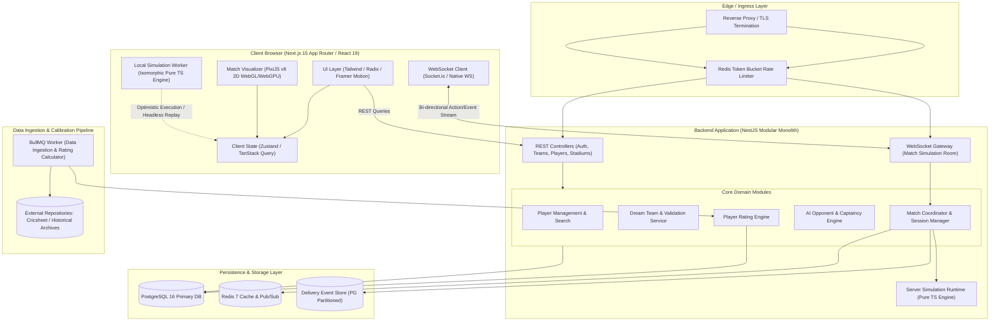
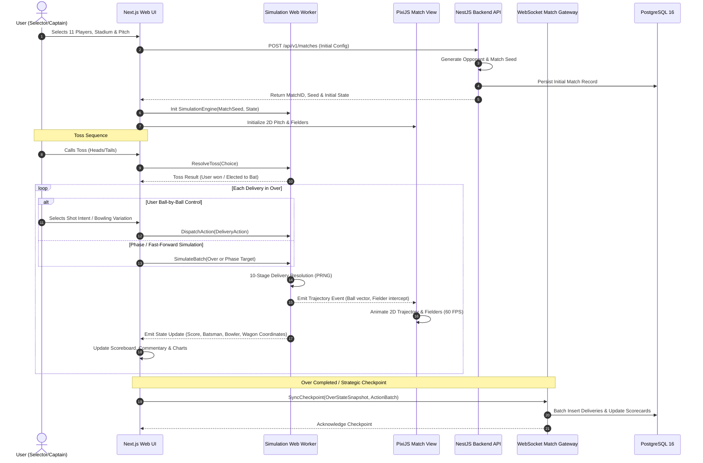

# System Architecture & Technical Design Document

**Document Version:** 1.0.0  
**Status:** DRAFT - AWAITING PHASE 0 REVIEW  
**Author:** Principal Game Architect & Simulation Systems Lead  
**Target Platform:** Web (Desktop, Tablet, Mobile Modern Browsers)  

---

## 1. Executive Summary & Product Vision

The **Global Cricket Dream Team & Simulation Game** is an authoritative, data-driven, tactical cricket simulation platform. It bridges the gap between deep statistical sports management engines (e.g., Football Manager, Out of the Park Baseball) and high-polish interactive web games. 

The application enables users to:
1. Curate dream teams across nations, eras, and formats.
2. Configure stadium, pitch deterioration, and atmospheric conditions.
3. Generate context-aware AI opponents calibrated by difficulty without artificial probability manipulation.
4. Experience a hybrid match loop: seamless switching between macroscopic phase-level strategic captaincy and microscopic ball-by-ball tactical control.
5. Replay, inspect, and analyze matches deterministically using seed-based event sourcing.

To ensure long-term maintainability, strict cricket correctness, and extreme performance, the core simulation engine is decoupled from all rendering, UI, database, and network infrastructure.

---

## 2. High-Level System Architecture

The system is organized as a **Modular Monolith** within a pnpm workspace monorepo. This eliminates distributed system overhead (network partitions, eventual consistency race conditions, complex RPCs) while strictly enforcing architectural boundaries between domains.



---

## 3. Monorepo Organization & Workspace Packages

The repository is structured with strict unidirectional dependencies. Reusable domain packages have zero dependencies on backend frameworks (NestJS) or frontend UI libraries (React/Next.js).

```text
cricket-dream-game/
│
├── apps/
│   ├── web/                         # Next.js 15 frontend, Tailwind CSS, Framer Motion
│   │   ├── app/                     # App router pages (hub, builder, match, replay)
│   │   ├── components/              # Shared UI design system components
│   │   ├── features/                # Feature modules (team-builder, toss, scoreboard)
│   │   ├── hooks/                   # Custom React hooks (useMatchStream, usePixiCanvas)
│   │   ├── lib/                     # Client utilities and API fetchers
│   │   └── workers/                 # Web Worker running simulation engine client-side
│   │
│   └── api/                         # NestJS backend application
│       ├── src/
│       │   ├── modules/
│       │   │   ├── auth/            # JWT authentication, session handling
│       │   │   ├── players/         # Player search, profiles, statistics
│       │   │   ├── teams/           # Dream Team CRUD, squad validation
│       │   │   ├── stadiums/        # Stadiums, pitch profiles, weather presets
│       │   │   ├── matches/         # Match setup, room gateway, state persistence
│       │   │   └── ai/              # AI opponent generation & captaincy adapters
│       │   └── main.ts              # Server bootstrap and WS adapter
│
├── packages/
│   ├── simulation-engine/           # PURE TS: Zero dependencies. Authoritative match logic
│   │   ├── src/
│   │   │   ├── core/                # State machine, PRNG, event dispatcher
│   │   │   ├── delivery/            # 10-stage delivery probability & physics model
│   │   │   ├── rules/               # Format-specific ruleset evaluators
│   │   │   ├── models/              # Immutable state interfaces and event types
│   │   │   └── replay/              # Seed verification and deterministic state rebuilder
│   │   └── package.json
│   │
│   ├── cricket-rules/               # Rule constants, field restriction boundaries, dismissals
│   ├── player-ratings/              # 5-factor rating model, era normalizer, confidence scorer
│   ├── ai-opponent/                 # Opponent selection heuristics, counter-picking, difficulty
│   ├── ai-captain/                  # In-match bowling rotation, field setting, batting aggression
│   ├── match-renderer/              # PixiJS v8 2D top-down field rendering & ball trajectory
│   ├── shared-types/                # Shared TypeScript DTOs, API contracts, WebSocket payloads
│   ├── data-ingestion/              # Cricsheet parser, identity deduplication, ETL scripts
│   └── validation/                  # Zod schemas for team rules, match inputs, API payloads
│
├── database/
│   ├── prisma/
│   │   ├── schema.prisma            # Normalized relational database schema
│   │   ├── migrations/              # Versioned SQL migrations
│   │   └── seed/                    # Baseline real-world players, teams, stadiums
│
├── docs/                            # Architectural specifications & technical designs
├── docker/                          # Dockerfiles and docker-compose configurations
└── pnpm-workspace.yaml
```

---

## 4. Architectural Decision Records (ADRs)

### ADR 001: Rendering Engine Selection (PixiJS v8 vs. Phaser 3 vs. Three.js)

* **Context:** The match view requires a stylized, high-performance, responsive 2D top-down cricket field with smooth ball trajectories, player position nodes, boundary effects, and interactive field setting overlays.
* **Options Considered:**
  1. *Phaser 3:* Full-featured 2D game engine. Includes physics, tilemaps, audio, input systems.
  2. *PixiJS v8:* Lightweight, hyper-fast WebGL/WebGPU 2D rendering library. Focused purely on scene graph and rendering.
  3. *Three.js:* 3D WebGL engine.
* **Decision:** **PixiJS v8**.
* **Rationale:** Phaser 3 bundles monolithic game loops, physics engines (Arcade/Matter.js), and audio systems that duplicate or conflict with our pure TypeScript simulation state machine. PixiJS v8 provides cutting-edge WebGPU/WebGL rendering, minimal bundle overhead (~120KB gzipped vs >1MB for Phaser), complete scene-graph flexibility, and easily wraps inside a React component without leaking memory across route changes. Three.js is deferred to Future Expansion (Phase 11 3D stadium view).

### ADR 002: Simulation Authority & Execution Model (Hybrid Isomorphic Model)

* **Context:** The user can play in full ball-by-ball manual mode or simulate fast multi-over phases (e.g. simulate 10 overs in 150ms). Doing every delivery strictly via client-server roundtrips creates latency lag and server compute strain; doing it exclusively client-side prevents cheat validation, match saving, and persistent analytics.
* **Options Considered:**
  1. *Server-Only Remote Simulation:* Every ball or phase requires an HTTP/WS roundtrip.
  2. *Client-Only Local Simulation:* Browser calculates everything; sends final scorecard to server.
  3. *Deterministic Hybrid Isomorphic Architecture:* The identical `@cricket/simulation-engine` TypeScript package runs in the browser Web Worker and on the NestJS backend.
* **Decision:** **Deterministic Hybrid Isomorphic Model**.
* **Rationale:**
  - In single-player mode, the browser Web Worker executes deliveries instantly with zero network lag, dispatching state to the PixiJS renderer.
  - The match state is completely deterministic, governed by `(InitialState, MatchSeed, ActionQueue)`.
  - At the end of each over or strategic phase, a cryptographically signed action log and state checkpoint are synchronized to the NestJS backend.
  - The server verifies state transitions either asynchronously or upon match completion by re-running the deterministic seed. If state diverges, the server-reconstructed state takes authority.
  - For future multiplayer, the engine seamlessly switches to server-authoritative live WebSocket streaming.

### ADR 003: Persistence Architecture & Delivery Storage Strategy

* **Context:** Cricket matches generate significant event volumes (approx. 240 deliveries for T20; up to 2,700 deliveries for a 5-day Test). Storing every ball delivery as an unindexed flat relational row causes query degradation; storing only final scorecards destroys ball-by-ball replayability, wagon wheels, and granular analytics.
* **Options Considered:**
  1. *Immediate Hash/Range Partitioning of Deliveries Table:* Partitioning `match_deliveries` from Day 1 across 4 to 12 PostgreSQL partitions.
  2. *Pure Event Sourcing Store (EventStoreDB / Kafka):* Storing raw streams without relational indexing.
  3. *Standard Relational Table with Composite B-Tree Indexing and Deferred Partitioning:* Normalized schema in PostgreSQL 16 with indexed foreign keys and defined performance triggers for future partitioning.
* **Decision:** **Standard Relational Schema with Targeted Composite Indexing (Deferred Partitioning)**.
* **Rationale & Benchmark Justification:**
  - Modern PostgreSQL 16 on standard NVMe storage easily handles **10 to 30 million rows** in a single table with sub-10ms B-tree index lookups on composite keys `(innings_id, delivery_sequence_number)`.
  - Immediate partitioning in Phase 1 introduces severe operational overhead: foreign key constraints across partitioned tables require complex maintenance, global unique indexes are restricted, and local migration complexity increases without measurable performance gain at MVP volume.
  - **Partitioning Trigger Benchmark:** The database will remain a standard relational table until:
    1. Table size exceeds **20,000,000 delivery rows**, OR
    2. Write throughput consistently exceeds **3,000 deliveries/second**, OR
    3. p95 query latency on delivery lookups exceeds **50 ms**.
  - At that threshold, a zero-downtime declarative hash or time-range partitioning migration will be executed. In MVP, data integrity, clean foreign keys, and fast index scans are prioritized.

### ADR 004: Pure Functional Simulation Core Boundary

* **Context:** If the cricket simulation engine touches browser globals (`window`, `document`), storage (`localStorage`, Prisma), or networking, it becomes impossible to test deterministically at scale, impossible to run in headless background workers, and difficult to calibrate.
* **Decision:** **Strict Functional Purity for `@cricket/simulation-engine`**.
* **Rationale:**
  - Signature: `simulateDelivery(currentState: Readonly<MatchState>, action: TacticalAction, prng: PRNG): DeliveryResolutionResult`.
  - The engine has **zero runtime dependencies**.
  - No clock calls (`Date.now()` is injected if needed; PRNG is deterministic).
  - State immutability is enforced using structural sharing.
  - Unit tests run thousands of matches per second in pure Node/V8 memory.

---

## 5. End-to-End Match Execution Pipeline



---

## 6. Simulation Versioning, Replay Integrity & Security

### 6.1 Comprehensive Simulation Versioning & State Invariants
Deterministic reproducibility requires that every component of the simulation logic is strictly versioned and immutable:
1. **`simulation_version` (Semantic Version, e.g. `sim-1.0.0`):** Encapsulates the 10-stage delivery resolution code, PRNG algorithms, and physics interpolators.
2. **`ruleset_version` (Versioned Rules Code, e.g. `rules-t20-icc-2026.1`):** Specifies field restriction boundaries, bowler quotas, dismissal exceptions, and tie-breaker logic.
3. **`rating_version` (Rating Model Version, e.g. `rate-1.0.0`):** Specifies attribute weights, era normalization baselines, and empirical Bayesian shrinkage constants.

### 6.2 Initial State Hash ($H_0$), Monotonic Sequencing & Replay Verification
- **Initial State Hash ($H_0$):**
  $$H_0 = \text{SHA-256}\left(\text{JSON.stringify}(\{ \text{seed}, \text{format}, \text{ruleset\_version}, \text{rating\_version}, \text{stadium}, \text{pitch}, \text{lineups} \})\right)$$
- **Monotonic Event Sequencing:** Every player action and resulting delivery event is assigned a strictly increasing integer sequence number ($k = 1, 2, \dots, N$).
- **Replay Verification Protocol:**
  Replay is verified by passing $(H_0, \text{Seed}, \text{ActionLog}, \text{SimVersion})$ to `@cricket/simulation-engine`. The pure engine deterministically computes state sequence $S_1, S_2, \dots, S_N$ and final hash $H_N$. If $H_N \equiv H_{\text{persisted}}$, the match state is certified authentic.

### 6.3 Anti-Cheat & Client Authority Clarification
- **Critical Distinction:** *Seed-based reproducibility alone is NOT cryptographic cheat prevention.* A malicious user with client-side debugger access can inspect pseudo-random states, manipulate local memory variables, or script optimal actions before sending them.
- **Authoritative Server Certification:** 
  - In single-player mode, local execution provides zero-latency rendering and auditability.
  - To certify any official result (e.g. tournament progression, record boards, or public profile scorecards), the backend NestJS service independently re-runs the initial seed with the user's sequential action inputs.
  - The server asserts that every action was legal given the game state at that exact delivery sequence number and that the resulting state hash matches byte-for-byte.
  - In competitive multiplayer modes, the execution model shifts entirely to server-authoritative live simulation via WebSockets, eliminating client-side simulation authority.

### 6.4 API & Data Protection
1. **Authentication & Identity:**
   - Stateless JWT tokens (Access token: 15-minute expiry; Refresh token: 7-day sliding expiry stored in HttpOnly, SameSite=Strict cookies).
   - Role-Based Access Control (RBAC): `USER`, `ANALYST`, `ADMIN`.
2. **API Protection:**
   - Rate limiting via Redis Token Bucket (100 requests/minute for standard API endpoints; 10 matches created/hour per user).
   - Input payload validation using strict Zod schemas at API boundary.
   - SQL Injection immunity via Prisma parameterization and raw query bans.

---

## 7. Performance Budgets & Operational Targets

| Metric | Target | Enforcement Mechanism |
|---|---|---|
| **Client Bundle Size (Initial Load)** | < 180 KB (gzipped) | Route-level code splitting, lazy loading PixiJS |
| **PixiJS Rendering Frame Rate** | Constant 60 FPS | Object pooling (zero GC in draw loop), sprite sheets |
| **Single Delivery Simulation Latency** | < 0.2 milliseconds | Pure typed arithmetic in V8, no allocations |
| **10-Over Phase Simulation Latency** | < 15 milliseconds | Headless batch loop in Web Worker |
| **WebSocket Checkpoint Sync Latency** | < 100 ms (p95) | Binary or compact JSON payloads, Redis caching |
| **Database Match Write Throughput** | > 1,500 deliveries/sec | Partitioned writes, bulk inserts per over |
| **Replay Reconstruction Duration** | < 500 ms for 40-over match | In-memory replay execution via seed |

---

## 8. Technology Stack Summary

* **Frontend:** Next.js 15 (React 19), TypeScript 5.6, Tailwind CSS v4, Radix UI, Framer Motion.
* **Match Visualization:** PixiJS v8 (Canvas 2D / WebGL / WebGPU fallback).
* **Backend:** NestJS 11, TypeScript, Socket.io / WebSocket Gateway, BullMQ (Redis-backed async queues).
* **Database & Cache:** PostgreSQL 16 (Relational tables + JSONB analytics), Redis 7 (Pub/sub, session cache, rate limiting), Prisma ORM v6.
* **Testing & QA:** Vitest (Unit & simulation invariant suites), Playwright (E2E match flow), fast-check (Property-based generative testing for cricket edge cases).
* **Tooling & Monorepo:** pnpm workspaces, Turborepo, Docker Compose.
