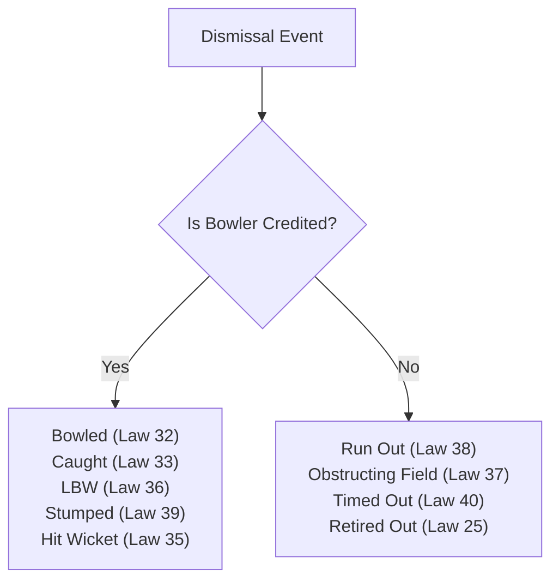

# Cricket Rules & Format Specifications

**Document Version:** 1.0.0  
**Status:** DRAFT - AWAITING PHASE 0 REVIEW  
**Package:** `@cricket/cricket-rules`  
**Reference Standard:** MCC Laws of Cricket (2017 Code, 3rd Edition - 2022) & ICC Standard Playing Conditions (2024–2026)  

---

## 1. Overview & Architecture

The cricket rules engine evaluates and enforces legal state transitions at every delivery, over boundary, and innings transition. Cricket rules are not hardcoded in the UI; they are implemented as **versioned, immutable ruleset evaluators** that receive the current match state and validate actions.

---

## 2. Format-by-Format Rules Matrix

| Rule Dimension | T10 | T20 | ODI | Test Red Ball | Test Pink Ball (Day/Night) |
|---|---|---|---|---|---|
| **Max Overs / Innings** | 10 overs | 20 overs | 50 overs | Unlimited | Unlimited |
| **Max Overs / Bowler** | 2 overs | 4 overs | 10 overs | Unlimited | Unlimited |
| **Innings per Team** | 1 | 1 | 1 | 2 | 2 |
| **Days / Sessions** | 1 day (90 mins) | 1 day (3.5 hrs) | 1 day (8 hrs) | 5 days / 3 sessions per day | 5 days / 3 sessions per day (D/N) |
| **Balls Used** | 1 white ball | 1 white ball | 2 new white balls (1 from each end) | 1 red ball (renewed after 80 ov) | 1 pink ball (renewed after 80 ov) |
| **Powerplay 1 (P1)** | Overs 1–3 (Max 2 out) | Overs 1–6 (Max 2 out) | Overs 1–10 (Max 2 out) | None (Min 2 close catchers in 1st 15 ov) | None (Min 2 close catchers in 1st 15 ov) |
| **Powerplay 2 (P2)** | None | None | Overs 11–40 (Max 4 out) | None | None |
| **Powerplay 3 (P3)** | None | None | Overs 41–50 (Max 5 out) | None | None |
| **Middle Overs Field** | Overs 4–8 (Max 4 out) | Overs 7–15 (Max 5 out) | (Included in P2) | Natural field (No circle restriction) | Natural field (No circle restriction) |
| **Death Overs Field** | Overs 9–10 (Max 5 out) | Overs 16–20 (Max 5 out) | (Included in P3) | Natural field | Natural field |
| **Free Hit on No-Ball** | Yes (All No-Balls) | Yes (All No-Balls) | Yes (All No-Balls) | No (Only 1 extra run + re-bowl) | No (Only 1 extra run + re-bowl) |
| **Follow-on Deficit** | N/A | N/A | N/A | 200 runs (5-day match) | 200 runs (5-day match) |
| **Declaration Allowed** | No | No | No | Yes (Anytime during innings) | Yes (Anytime during innings) |
| **Tie Resolution** | Super Over | Super Over | Super Over | Tie (Scores level & all out) | Tie (Scores level & all out) |
| **Draw Outcome** | Impossible | Impossible | Impossible | Yes (Overs expire without win) | Yes (Overs expire without win) |

---

## 3. Detailed Format Specifications

### 3.1 T10 Cricket
* **Pacing & Philosophy:** Hyper-aggressive. Dot-ball penalty is extreme. Batters attack from ball 1.
* **Field Restrictions:**
  - Overs 1–3 (Mandatory Powerplay): Maximum 2 fielders permitted outside the 30-yard fielding circle.
  - Overs 4–10: Maximum 5 fielders permitted outside the circle.
* **Bowling Restrictions:** No bowler may bowl more than 2 overs. At least 5 distinct bowlers must be utilized.

### 3.2 T20 Cricket (ICC Standard)
* **Pacing & Phases:**
  - *Powerplay (Overs 1–6):* Maximum 2 fielders outside the circle. Pitch is pristine; new white ball swings for 1–3 overs.
  - *Middle Overs (Overs 7–15):* Maximum 5 fielders outside the circle. Spinners introduced to choke run rate; strike rotation prioritizes 1s and 2s.
  - *Death Overs (Overs 16–20):* Maximum 5 fielders outside. Aggression ramps to maximum; specialist yorker and slower-ball bowlers deployed.
* **Bowling Restrictions:** Maximum 4 overs per bowler. Minimum 5 bowlers required per innings.

### 3.3 One Day International (ODI)
* **Ball Configuration:** Two new white Kookaburra/Dukes balls used alternately from each end throughout the entire innings (50 overs). Each ball only completes 25 overs, significantly reducing reverse swing and keeping the ball hard throughout the innings.
* **Three-Stage Powerplay System:**
  - *Powerplay 1 (Overs 1–10):* Mandatory. Maximum 2 fielders outside 30-yard circle.
  - *Powerplay 2 (Overs 11–40):* Maximum 4 fielders outside 30-yard circle.
  - *Powerplay 3 (Overs 41–50):* Maximum 5 fielders outside 30-yard circle.
* **Bowling Restrictions:** Maximum 10 overs per bowler.

### 3.4 Test Cricket (Red Ball)
* **Structure & Schedule:**
  - Up to 5 consecutive days. Minimum 90 overs scheduled per day.
  - Daily structure: 3 sessions of 2 hours each.
    - Session 1 (Morning): 30 overs. 40-minute Lunch interval.
    - Session 2 (Afternoon): 30 overs. 20-minute Tea interval.
    - Session 3 (Evening): 30 overs. Stumps called.
* **New Ball Regulations:** The bowling captain has the option to take a brand-new red ball after 80 overs have been bowled with the old ball (MCC Law 4.3). Taking the new ball instantly resets ball hardness, increasing swing and seam movement while sacrificing spin grip.
* **Follow-on:** In a 5-day match, if Team B trails Team A by 200 or more runs after their first completed innings, Team A's captain has the option to enforce the follow-on, compelling Team B to bat again immediately in Innings 3.
* **Declarations:** The batting captain may declare an innings closed at any stoppage in play (MCC Law 15).
* **Test Match Outcomes:**
  - **Win:** Team batting 4th successfully reaches target, OR team bowling 4th bowls opposition out before target is reached.
  - **Draw:** Time/overs expire on Day 5 without the 4th innings reaching a conclusion.
  - **Tie:** The scores are exactly equal AND the team batting 4th is bowled all out (extremely rare historical occurrence).

### 3.5 Test Cricket (Pink Ball Day/Night)
* **Session Schedule:** Shifted into the afternoon and evening:
  - Session 1 (Afternoon): Natural sunlight.
  - Session 2 (Twilight/Sunset): Rapidly shifting light conditions; floodlights take effect.
  - Session 3 (Night): Complete artificial floodlighting.
* **Pink Ball Mechanics:**
  - Uses extra polyurethane lacquer to preserve color visibility under artificial lights.
  - **The Twilight Effect:** During the 45-minute twilight period as natural light fades and floodlights take over, contrast drops. Batter reaction times are reduced by 15%, and the ball moves significantly more in the air (+25% swing/seam).
  - **Dew Factor in Session 3:** If humidity is high, moisture on the outfield softens the pink ball lacquer, dampens seam grip, and reduces reverse swing potential.

---

## 4. Cricket Extras & Penalty Rules

### 4.1 Wide Ball (MCC Law 22)
- Assessed when the ball passes out of reach of the striker playing in a normal batting stance, or down the leg-side (strict white-ball interpretation).
- Outcome: 1 run added to team extras (`wides`); delivery does NOT count as a legal ball in the over and must be re-bowled.
- Striker cannot be dismissed: Bowled, Caught, LBW, or Hit Wicket (unless off the return action).
- Striker CAN be dismissed: Stumped (Law 39) or Run Out (Law 38).

### 4.2 No-Ball (MCC Law 21)
- Assessed for:
  - Front-foot overstepping (popping crease completely breached).
  - Back-foot touching or cutting return crease.
  - Beamers: Full toss above waist height of the striker standing upright.
  - More than 2 fielders behind square on the leg side at instant of delivery.
  - Breach of field restriction circle limits.
- Outcome: 1 run added to team extras (`no_balls`); delivery does NOT count as a legal ball and must be re-bowled.
- **Free Hit Rule (White Ball formats only):**
  - The delivery immediately following a No-Ball is designated a **Free Hit**.
  - For the Free Hit delivery, the striker cannot be dismissed by any means other than:
    1. Run Out.
    2. Obstructing the Field.
    3. Hitting the Ball Twice.
  - Field placements cannot be changed for the Free Hit delivery unless there was a change of striker on the No-Ball.

### 4.3 Byes and Leg-Byes (MCC Law 23)
- **Leg-Bye:** Ball strikes batter's person or protective equipment (other than bat or glove holding bat) provided the batter either (a) attempted to play the ball with the bat, or (b) attempted to avoid being hit.
- **Bye:** Ball passes the batter without touching bat or body.
- Scored as team extras; strike rotates normally on odd runs. Does not count against bowler's economy analysis in formal records.

---

## 5. Dismissal Classification & Rules Validation

### 5.1 LBW (Leg Before Wicket - MCC Law 36)
A batter is out LBW if all three criteria are satisfied:
1. **Pitching Condition:** The ball must pitch either (a) in line between the wickets, or (b) outside the off-stump. If the ball pitches outside leg-stump, the batter is **NOT OUT** (regardless of impact or trajectory).
2. **Impact Condition:** The first intercept with the batter's person must be in line between wicket and wicket, UNLESS the batter made no genuine attempt to play a shot with the bat (in which case impact outside off-stump is out).
3. **Wicket Trajectory:** The ball would have gone on to strike the stumps.

### 5.2 Caught (MCC Law 33)
- Ball touches bat or glove holding bat and is caught cleanly by a fielder without touching the ground.
- **Boundary Verification:** The fielder must be completely inside the boundary rope. If the fielder's body or clothing touches the rope while in contact with the ball, the catch is void and a **SIX** is awarded.
- **Batters Crossing Rule (2022 Update):** When a batter is caught, the new incoming batter MUST take strike at the end the dismissed batter occupied, regardless of whether the batters crossed before the catch was taken.

### 5.3 Run Out (MCC Law 38)
- Occurs when a wicket is broken while the batter's bat or person is not grounded behind the popping crease during active play.
- If batters cross, the batter running towards the end where the stumps were broken is dismissed.
- Bowler is NOT credited with the wicket in bowling figures.

---

## 6. Super Over / Tie-Breaking Protocol

For T10, T20, and ODI knockout matches where scores are tied after both innings:
1. Both teams nominate 3 batters and 1 bowler.
2. Innings consists of 1 over (6 legal deliveries).
3. Innings terminates immediately if 2 wickets fall.
4. The team batting second in the main match bats first in Super Over 1.
5. If Super Over 1 is tied, **successive Super Overs are played** until a winner is determined.
6. The controversial 2019 "Boundary Countback Rule" is strictly deprecated and not used in this simulation engine.

---

## 7. Rain Interruptions, Target Adjustments & The DLS Method

### 7.1 Policy Regarding Official DLS (Duckworth-Lewis-Stern)
* **Proprietary Software Boundary:** The official "DLS Professional Edition" mathematical resource tables and computer software are proprietary assets owned and licensed exclusively by the International Cricket Council (ICC).
* **Zero False Compatibility Claims:** The game engine will **NEVER** claim official DLS compatibility or brand its target calculations as official ICC DLS without a verified commercial licensing agreement.

### 7.2 MVP Scope Boundary (Phases 1–8)
* In the initial playable MVP (T20 Dream Match mode), matches are simulated under complete, uninterrupted playing conditions (full 20 overs per innings).
* Atmospheric environmental factors (humidity, cloud cover, temperature, evening dew) are fully simulated in real time and dynamically modulate ball swing, pitch bounce, and bowler grip on every ball.
* Mid-innings rain stoppages and premature over reductions are **strictly excluded from the MVP scope** to prevent frustrating interruptions in single-player tactical gameplay until validated and legally cleared target-adjustment models are integrated.

### 7.3 Post-MVP Target Recalculation Methods (Phase 9+)
When over-reduction rules are introduced in future tournament modes, the ruleset evaluator will support:
1. **D/L Standard Edition (1998/2004):** Publicly published mathematical resource percentage tables using single-factor exponential decay curves.
2. **The VJD Method (V. Jayadevan):** Alternative open mathematical curve system accounting for modern scoring accelerations across normal and target overs.
3. Any such implementation will be explicitly labeled in the UI as an **"In-Game Standard Target Adjustment"**, maintaining full transparency with the player.
