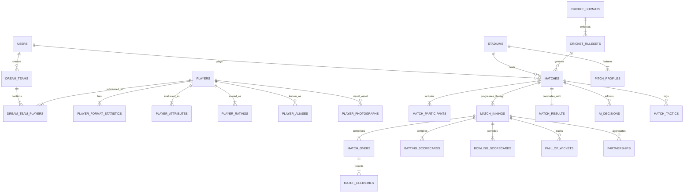

# Database Schema & Relational Architecture

**Document Version:** 1.0.0  
**Status:** DRAFT - AWAITING PHASE 0 REVIEW  
**Database Engine:** PostgreSQL 16  
**ORM / Data Access:** Prisma ORM v6  

---

## 1. Relational Entity-Relationship Diagram (ERD)



---

## 2. Complete PostgreSQL Data Definition Language (DDL)

### 2.1 System & Reference Domain

```sql
-- Extensions
CREATE EXTENSION IF NOT EXISTS "uuid-ossp";
CREATE EXTENSION IF NOT EXISTS "pgcrypto";

-- Enums
CREATE TYPE user_role_enum AS ENUM ('USER', 'ANALYST', 'ADMIN');
CREATE TYPE historical_era_enum AS ENUM (
    'GOLDEN_AGE_PRE_1914',
    'INTERWAR_1919_1939',
    'POST_WAR_1946_1970',
    'PACE_REVOLUTION_1971_1991',
    'GLOBALIZED_1992_2007',
    'T20_REVOLUTION_2008_2020',
    'CONTEMPORARY_2021_PRESENT'
);
CREATE TYPE primary_role_enum AS ENUM (
    'TOP_ORDER_BATTER',
    'MIDDLE_ORDER_BATTER',
    'WICKETKEEPER_BATTER',
    'BATTING_ALL_ROUNDER',
    'BOWLING_ALL_ROUNDER',
    'PACE_BOWLER',
    'SPIN_BOWLER'
);
CREATE TYPE batting_hand_enum AS ENUM ('RIGHT_HAND', 'LEFT_HAND');
CREATE TYPE bowling_style_enum AS ENUM (
    'RIGHT_ARM_FAST',
    'RIGHT_ARM_FAST_MEDIUM',
    'RIGHT_ARM_MEDIUM',
    'LEFT_ARM_FAST',
    'LEFT_ARM_FAST_MEDIUM',
    'LEFT_ARM_MEDIUM',
    'RIGHT_ARM_OFF_BREAK',
    'RIGHT_ARM_LEG_BREAK',
    'LEFT_ARM_ORTHODOX',
    'LEFT_ARM_UNORTHODOX',
    'NONE'
);
CREATE TYPE match_format_enum AS ENUM ('T10', 'T20', 'ODI', 'TEST_RED_BALL', 'TEST_PINK_BALL');
CREATE TYPE pitch_type_enum AS ENUM (
    'GREEN', 'DRY', 'DUSTY', 'FLAT_BATTING', 
    'HARD_BOUNCY', 'SLOW', 'TURNING', 'BALANCED'
);
CREATE TYPE match_status_enum AS ENUM (
    'SCHEDULED', 'TOSS_PENDING', 'IN_PROGRESS', 
    'INNINGS_BREAK', 'COMPLETED', 'ABANDONED'
);
CREATE TYPE dismissal_type_enum AS ENUM (
    'BOWLED', 'CAUGHT', 'LBW', 'RUN_OUT', 
    'STUMPED', 'HIT_WICKET', 'RETIRED_OUT', 
    'RETIRED_HURT', 'OBSTRUCTING_FIELD', 'NOT_OUT'
);
CREATE TYPE difficulty_level_enum AS ENUM ('EASY', 'MEDIUM', 'HARD');

---

-- Users Table
CREATE TABLE users (
    id UUID PRIMARY KEY DEFAULT gen_random_uuid(),
    email VARCHAR(255) NOT NULL UNIQUE,
    username VARCHAR(50) NOT NULL UNIQUE,
    password_hash VARCHAR(255) NOT NULL,
    role user_role_enum NOT NULL DEFAULT 'USER',
    avatar_url TEXT,
    created_at TIMESTAMPTZ NOT NULL DEFAULT NOW(),
    updated_at TIMESTAMPTZ NOT NULL DEFAULT NOW()
);

-- User Preferences
CREATE TABLE user_preferences (
    user_id UUID PRIMARY KEY REFERENCES users(id) ON DELETE CASCADE,
    preferred_format match_format_enum NOT NULL DEFAULT 'T20',
    default_difficulty difficulty_level_enum NOT NULL DEFAULT 'MEDIUM',
    preferred_camera_angle VARCHAR(32) NOT NULL DEFAULT 'TOP_DOWN_CLASSIC',
    audio_enabled BOOLEAN NOT NULL DEFAULT TRUE,
    commentary_speed VARCHAR(16) NOT NULL DEFAULT 'NORMAL',
    updated_at TIMESTAMPTZ NOT NULL DEFAULT NOW()
);
```

### 2.2 Cricket Reference & Ground Domain

```sql
-- Cricket Formats
CREATE TABLE cricket_formats (
    code match_format_enum PRIMARY KEY,
    name VARCHAR(64) NOT NULL,
    default_max_overs_per_innings INT,
    max_overs_per_bowler INT,
    innings_per_team INT NOT NULL DEFAULT 1,
    is_multiday BOOLEAN NOT NULL DEFAULT FALSE,
    powerplay_overs_p1 INT NOT NULL,
    powerplay_overs_p2 INT NOT NULL DEFAULT 0,
    powerplay_overs_p3 INT NOT NULL DEFAULT 0,
    created_at TIMESTAMPTZ NOT NULL DEFAULT NOW()
);

-- Cricket Rulesets (Versioned rules engine configs)
CREATE TABLE cricket_rulesets (
    id VARCHAR(64) PRIMARY KEY, -- e.g. 'T20_ICC_2026', 'TEST_WTC_2026'
    format_code match_format_enum NOT NULL REFERENCES cricket_formats(code),
    version VARCHAR(32) NOT NULL,
    front_foot_no_ball_free_hit BOOLEAN NOT NULL DEFAULT TRUE,
    super_over_enabled BOOLEAN NOT NULL DEFAULT TRUE,
    drs_reviews_per_innings INT NOT NULL DEFAULT 2,
    follow_on_deficit INT NOT NULL DEFAULT 200,
    new_ball_overs INT NOT NULL DEFAULT 80,
    concussion_sub_allowed BOOLEAN NOT NULL DEFAULT TRUE,
    config_json JSONB NOT NULL,
    is_active BOOLEAN NOT NULL DEFAULT TRUE,
    created_at TIMESTAMPTZ NOT NULL DEFAULT NOW()
);

-- Stadiums
CREATE TABLE stadiums (
    id UUID PRIMARY KEY DEFAULT gen_random_uuid(),
    official_name VARCHAR(255) NOT NULL,
    common_name VARCHAR(128) NOT NULL,
    country VARCHAR(64) NOT NULL,
    city VARCHAR(64) NOT NULL,
    latitude DECIMAL(9, 6) NOT NULL,
    longitude DECIMAL(9, 6) NOT NULL,
    capacity INT,
    straight_boundary_meters DECIMAL(4, 1) NOT NULL DEFAULT 70.0,
    square_boundary_meters DECIMAL(4, 1) NOT NULL DEFAULT 65.0,
    altitude_meters INT NOT NULL DEFAULT 0,
    has_floodlights BOOLEAN NOT NULL DEFAULT TRUE,
    typical_pace_modifier DECIMAL(3, 2) NOT NULL DEFAULT 1.00,
    typical_spin_modifier DECIMAL(3, 2) NOT NULL DEFAULT 1.00,
    is_active BOOLEAN NOT NULL DEFAULT TRUE,
    created_at TIMESTAMPTZ NOT NULL DEFAULT NOW()
);

-- Pitch Profiles
CREATE TABLE pitch_profiles (
    id UUID PRIMARY KEY DEFAULT gen_random_uuid(),
    stadium_id UUID NOT NULL REFERENCES stadiums(id) ON DELETE CASCADE,
    pitch_type pitch_type_enum NOT NULL,
    name VARCHAR(128) NOT NULL,
    base_bounce_rating INT NOT NULL CHECK (base_bounce_rating BETWEEN 0 AND 100),
    base_seam_rating INT NOT NULL CHECK (base_seam_rating BETWEEN 0 AND 100),
    base_spin_rating INT NOT NULL CHECK (base_spin_rating BETWEEN 0 AND 100),
    base_pace_rating INT NOT NULL CHECK (base_pace_rating BETWEEN 0 AND 100),
    deterioration_rate DECIMAL(3, 2) NOT NULL DEFAULT 1.00,
    cracking_tendency DECIMAL(3, 2) NOT NULL DEFAULT 1.00,
    created_at TIMESTAMPTZ NOT NULL DEFAULT NOW()
);
```

### 2.3 Player Domain

```sql
-- Players Master Table
CREATE TABLE players (
    id UUID PRIMARY KEY DEFAULT gen_random_uuid(),
    cricsheet_id VARCHAR(64) UNIQUE,
    full_name VARCHAR(128) NOT NULL,
    display_name VARCHAR(64) NOT NULL,
    date_of_birth DATE,
    primary_nationality VARCHAR(64) NOT NULL,
    primary_role primary_role_enum NOT NULL,
    secondary_role VARCHAR(64),
    batting_hand batting_hand_enum NOT NULL,
    bowling_style bowling_style_enum NOT NULL DEFAULT 'NONE',
    is_wicketkeeper BOOLEAN NOT NULL DEFAULT FALSE,
    historical_era historical_era_enum NOT NULL,
    career_debut_year INT NOT NULL,
    career_retirement_year INT,
    is_active BOOLEAN NOT NULL DEFAULT FALSE,
    confidence_score DECIMAL(3, 2) NOT NULL DEFAULT 1.00 CHECK (confidence_score BETWEEN 0.00 AND 1.00),
    created_at TIMESTAMPTZ NOT NULL DEFAULT NOW(),
    updated_at TIMESTAMPTZ NOT NULL DEFAULT NOW()
);

CREATE INDEX idx_players_search ON players (display_name, primary_nationality, primary_role, historical_era);

-- Player Aliases (for identity deduplication)
CREATE TABLE player_aliases (
    id UUID PRIMARY KEY DEFAULT gen_random_uuid(),
    player_id UUID NOT NULL REFERENCES players(id) ON DELETE CASCADE,
    alias_name VARCHAR(128) NOT NULL,
    source_identifier VARCHAR(64),
    UNIQUE (player_id, alias_name)
);

-- Player Photographs (Strict License Tracking)
CREATE TABLE player_photographs (
    id UUID PRIMARY KEY DEFAULT gen_random_uuid(),
    player_id UUID NOT NULL REFERENCES players(id) ON DELETE CASCADE,
    image_url TEXT NOT NULL,
    thumbnail_url TEXT NOT NULL,
    license_type VARCHAR(64) NOT NULL, -- e.g. 'CC-BY-SA-4.0', 'PUBLIC_DOMAIN', 'PROPRIETARY'
    attribution_text TEXT NOT NULL,
    is_verified BOOLEAN NOT NULL DEFAULT FALSE,
    is_primary BOOLEAN NOT NULL DEFAULT TRUE,
    created_at TIMESTAMPTZ NOT NULL DEFAULT NOW()
);

-- Player Format-Specific Raw Statistics (Decoupled by format; strictly unadjusted raw numbers)
CREATE TABLE player_format_statistics (
    id UUID PRIMARY KEY DEFAULT gen_random_uuid(),
    player_id UUID NOT NULL REFERENCES players(id) ON DELETE CASCADE,
    format_code match_format_enum NOT NULL REFERENCES cricket_formats(code),
    matches_played INT NOT NULL DEFAULT 0,
    innings_batted INT NOT NULL DEFAULT 0,
    runs_scored INT NOT NULL DEFAULT 0,
    highest_score INT NOT NULL DEFAULT 0,
    is_highest_score_not_out BOOLEAN NOT NULL DEFAULT FALSE,
    batting_average DECIMAL(6, 2),
    strike_rate DECIMAL(6, 2),
    centuries INT NOT NULL DEFAULT 0,
    half_centuries INT NOT NULL DEFAULT 0,
    fours INT NOT NULL DEFAULT 0,
    sixes INT NOT NULL DEFAULT 0,
    balls_bowled INT NOT NULL DEFAULT 0,
    runs_conceded INT NOT NULL DEFAULT 0,
    wickets_taken INT NOT NULL DEFAULT 0,
    bowling_average DECIMAL(6, 2),
    economy_rate DECIMAL(6, 2),
    bowling_strike_rate DECIMAL(6, 2),
    five_wicket_hauls INT NOT NULL DEFAULT 0,
    catches_taken INT NOT NULL DEFAULT 0,
    stumpings_made INT NOT NULL DEFAULT 0,
    data_source_id UUID,
    updated_at TIMESTAMPTZ NOT NULL DEFAULT NOW(),
    UNIQUE (player_id, format_code)
);

-- Layer 2: Era-Adjusted Metrics (Peer-cohort normalized; rolling 10-year baseline)
CREATE TABLE player_era_metrics (
    id UUID PRIMARY KEY DEFAULT gen_random_uuid(),
    player_id UUID NOT NULL REFERENCES players(id) ON DELETE CASCADE,
    format_code match_format_enum NOT NULL REFERENCES cricket_formats(code),
    era_bracket historical_era_enum NOT NULL,
    era_peer_batting_avg_mean DECIMAL(5, 2) NOT NULL,
    era_peer_batting_avg_std DECIMAL(5, 2) NOT NULL,
    era_peer_strike_rate_mean DECIMAL(5, 2) NOT NULL,
    era_peer_strike_rate_std DECIMAL(5, 2) NOT NULL,
    era_peer_bowling_avg_mean DECIMAL(5, 2) NOT NULL,
    era_peer_bowling_avg_std DECIMAL(5, 2) NOT NULL,
    era_peer_economy_mean DECIMAL(5, 2) NOT NULL,
    era_peer_economy_std DECIMAL(5, 2) NOT NULL,
    
    -- Calculated Z-Scores and Era Performance Ratios (EPR)
    batting_avg_z_score DECIMAL(5, 3) NOT NULL,
    strike_rate_z_score DECIMAL(5, 3) NOT NULL,
    bowling_avg_z_score DECIMAL(5, 3) NOT NULL,
    economy_z_score DECIMAL(5, 3) NOT NULL,
    era_performance_ratio DECIMAL(5, 3) NOT NULL DEFAULT 1.000,
    
    normalization_version VARCHAR(32) NOT NULL DEFAULT 'v1.0.0',
    updated_at TIMESTAMPTZ NOT NULL DEFAULT NOW(),
    UNIQUE (player_id, format_code, normalization_version)
);

-- Multi-Dimensional Player Attributes (5 Core Dimensions, 0-100 scale)
CREATE TABLE player_attributes (
    id UUID PRIMARY KEY DEFAULT gen_random_uuid(),
    player_id UUID NOT NULL REFERENCES players(id) ON DELETE CASCADE,
    
    -- Batting (0-100)
    technique INT NOT NULL CHECK (technique BETWEEN 0 AND 100),
    timing INT NOT NULL CHECK (timing BETWEEN 0 AND 100),
    power INT NOT NULL CHECK (power BETWEEN 0 AND 100),
    strike_rotation INT NOT NULL CHECK (strike_rotation BETWEEN 0 AND 100),
    defensive_ability INT NOT NULL CHECK (defensive_ability BETWEEN 0 AND 100),
    against_pace INT NOT NULL CHECK (against_pace BETWEEN 0 AND 100),
    against_spin INT NOT NULL CHECK (against_spin BETWEEN 0 AND 100),
    short_ball_handling INT NOT NULL CHECK (short_ball_handling BETWEEN 0 AND 100),
    yorker_handling INT NOT NULL CHECK (yorker_handling BETWEEN 0 AND 100),
    death_over_batting INT NOT NULL CHECK (death_over_batting BETWEEN 0 AND 100),
    
    -- Bowling (0-100)
    line_and_length INT NOT NULL CHECK (line_and_length BETWEEN 0 AND 100),
    pace_or_spin_execution INT NOT NULL CHECK (pace_or_spin_execution BETWEEN 0 AND 100),
    swing_or_drift INT NOT NULL CHECK (swing_or_drift BETWEEN 0 AND 100),
    seam_or_turn INT NOT NULL CHECK (seam_or_turn BETWEEN 0 AND 100),
    accuracy INT NOT NULL CHECK (accuracy BETWEEN 0 AND 100),
    variation INT NOT NULL CHECK (variation BETWEEN 0 AND 100),
    yorker_execution INT NOT NULL CHECK (yorker_execution BETWEEN 0 AND 100),
    death_over_bowling INT NOT NULL CHECK (death_over_bowling BETWEEN 0 AND 100),
    new_ball_effectiveness INT NOT NULL CHECK (new_ball_effectiveness BETWEEN 0 AND 100),
    stamina INT NOT NULL CHECK (stamina BETWEEN 0 AND 100),
    
    -- Fielding (0-100)
    catching INT NOT NULL CHECK (catching BETWEEN 0 AND 100),
    reflexes INT NOT NULL CHECK (reflexes BETWEEN 0 AND 100),
    ground_fielding INT NOT NULL CHECK (ground_fielding BETWEEN 0 AND 100),
    throwing_accuracy INT NOT NULL CHECK (throwing_accuracy BETWEEN 0 AND 100),
    wicketkeeping INT NOT NULL CHECK (wicketkeeping BETWEEN 0 AND 100),
    
    -- Temperament (0-100)
    pressure_handling INT NOT NULL CHECK (pressure_handling BETWEEN 0 AND 100),
    consistency INT NOT NULL CHECK (consistency BETWEEN 0 AND 100),
    decision_making INT NOT NULL CHECK (decision_making BETWEEN 0 AND 100),
    
    -- Adaptability (0-100)
    pitch_adaptability INT NOT NULL CHECK (pitch_adaptability BETWEEN 0 AND 100),
    weather_adaptability INT NOT NULL CHECK (weather_adaptability BETWEEN 0 AND 100),
    
    version VARCHAR(32) NOT NULL DEFAULT 'v1.0.0',
    updated_at TIMESTAMPTZ NOT NULL DEFAULT NOW(),
    UNIQUE (player_id, version)
);

-- Format-Specific Derived Ratings
CREATE TABLE player_ratings (
    id UUID PRIMARY KEY DEFAULT gen_random_uuid(),
    player_id UUID NOT NULL REFERENCES players(id) ON DELETE CASCADE,
    format_code match_format_enum NOT NULL REFERENCES cricket_formats(code),
    overall_rating INT NOT NULL CHECK (overall_rating BETWEEN 0 AND 100),
    batting_rating INT NOT NULL CHECK (batting_rating BETWEEN 0 AND 100),
    bowling_rating INT NOT NULL CHECK (bowling_rating BETWEEN 0 AND 100),
    fielding_rating INT NOT NULL CHECK (fielding_rating BETWEEN 0 AND 100),
    rating_version VARCHAR(32) NOT NULL DEFAULT 'v1.0.0',
    era_normalized_multiplier DECIMAL(4, 3) NOT NULL DEFAULT 1.000,
    confidence_tier VARCHAR(16) NOT NULL CHECK (confidence_tier IN ('MEASURED', 'ESTIMATED', 'IMPUTED')),
    updated_at TIMESTAMPTZ NOT NULL DEFAULT NOW(),
    UNIQUE (player_id, format_code, rating_version)
);
```

### 2.4 Dream Team Domain

```sql
-- Dream Teams Created by Users
CREATE TABLE dream_teams (
    id UUID PRIMARY KEY DEFAULT gen_random_uuid(),
    user_id UUID NOT NULL REFERENCES users(id) ON DELETE CASCADE,
    team_name VARCHAR(64) NOT NULL,
    badge_icon VARCHAR(64) NOT NULL DEFAULT 'SHIELD_CLASSIC',
    primary_color VARCHAR(7) NOT NULL DEFAULT '#0D4A38',
    secondary_color VARCHAR(7) NOT NULL DEFAULT '#D4AF37',
    format_code match_format_enum NOT NULL REFERENCES cricket_formats(code),
    overall_strength_rating INT NOT NULL DEFAULT 0,
    batting_strength_rating INT NOT NULL DEFAULT 0,
    bowling_strength_rating INT NOT NULL DEFAULT 0,
    is_valid BOOLEAN NOT NULL DEFAULT FALSE,
    created_at TIMESTAMPTZ NOT NULL DEFAULT NOW(),
    updated_at TIMESTAMPTZ NOT NULL DEFAULT NOW()
);

-- Dream Team Lineup (11 Players per Team)
CREATE TABLE dream_team_players (
    id UUID PRIMARY KEY DEFAULT gen_random_uuid(),
    dream_team_id UUID NOT NULL REFERENCES dream_teams(id) ON DELETE CASCADE,
    player_id UUID NOT NULL REFERENCES players(id) ON DELETE RESTRICT,
    batting_order INT NOT NULL CHECK (batting_order BETWEEN 1 AND 11),
    is_captain BOOLEAN NOT NULL DEFAULT FALSE,
    is_vice_captain BOOLEAN NOT NULL DEFAULT FALSE,
    is_designated_wicketkeeper BOOLEAN NOT NULL DEFAULT FALSE,
    bowling_priority INT CHECK (bowling_priority BETWEEN 1 AND 7), -- 1: Strike bowler, 2: Opening partner, etc.
    UNIQUE (dream_team_id, batting_order),
    UNIQUE (dream_team_id, player_id)
);
```

### 2.5 Match & Simulation Persistence Domain

```sql
-- Matches Master Table (Supports Limited Overs and Multi-Day Test Formats)
CREATE TABLE matches (
    id UUID PRIMARY KEY DEFAULT gen_random_uuid(),
    ruleset_id VARCHAR(64) NOT NULL REFERENCES cricket_rulesets(id),
    stadium_id UUID NOT NULL REFERENCES stadiums(id),
    pitch_profile_id UUID NOT NULL REFERENCES pitch_profiles(id),
    user_id UUID NOT NULL REFERENCES users(id),
    format_code match_format_enum NOT NULL REFERENCES cricket_formats(code),
    difficulty difficulty_level_enum NOT NULL DEFAULT 'MEDIUM',
    match_seed BIGINT NOT NULL, -- Deterministic PRNG Seed
    
    -- Versioning Triad for Complete Deterministic Reproducibility
    simulation_version VARCHAR(32) NOT NULL DEFAULT 'sim-1.0.0',
    ruleset_version VARCHAR(32) NOT NULL DEFAULT 'rules-1.0.0',
    rating_version VARCHAR(32) NOT NULL DEFAULT 'rate-1.0.0',
    initial_state_hash VARCHAR(64) NOT NULL, -- SHA-256 of Initial State (H0)
    
    status match_status_enum NOT NULL DEFAULT 'SCHEDULED',
    toss_winner_team_id UUID,
    toss_decision VARCHAR(16) CHECK (toss_decision IN ('BAT', 'BOWL')),
    current_innings_number INT NOT NULL DEFAULT 1 CHECK (current_innings_number BETWEEN 1 AND 4),
    scheduled_overs INT NOT NULL,
    
    -- Multi-Day Test Match Session & Condition Tracking
    current_day_number INT NOT NULL DEFAULT 1 CHECK (current_day_number BETWEEN 1 AND 5),
    current_session_number INT NOT NULL DEFAULT 1 CHECK (current_session_number BETWEEN 1 AND 3),
    overs_remaining_today INT NOT NULL DEFAULT 90,
    pitch_wear_index DECIMAL(3, 2) NOT NULL DEFAULT 0.00 CHECK (pitch_wear_index BETWEEN 0.00 AND 1.00),
    surface_cracks_index DECIMAL(3, 2) NOT NULL DEFAULT 0.00 CHECK (surface_cracks_index BETWEEN 0.00 AND 1.00),
    is_follow_on_enforced BOOLEAN NOT NULL DEFAULT FALSE,
    
    ambient_temperature_celsius INT NOT NULL DEFAULT 24,
    humidity_percentage INT NOT NULL DEFAULT 55,
    cloud_cover_percentage INT NOT NULL DEFAULT 20,
    dew_factor DECIMAL(3, 2) NOT NULL DEFAULT 0.00,
    created_at TIMESTAMPTZ NOT NULL DEFAULT NOW(),
    completed_at TIMESTAMPTZ
);

-- Match Participants (Team A: User, Team B: AI)
CREATE TABLE match_participants (
    id UUID PRIMARY KEY DEFAULT gen_random_uuid(),
    match_id UUID NOT NULL REFERENCES matches(id) ON DELETE CASCADE,
    team_name VARCHAR(64) NOT NULL,
    is_ai BOOLEAN NOT NULL DEFAULT FALSE,
    dream_team_id UUID REFERENCES dream_teams(id),
    captain_player_id UUID NOT NULL REFERENCES players(id),
    wicketkeeper_player_id UUID NOT NULL REFERENCES players(id),
    lineup_json JSONB NOT NULL, -- Snapshot of 11 player ratings & attributes at match time
    UNIQUE (match_id, is_ai)
);

-- Match Innings (Supports up to 4 innings for Test matches)
CREATE TABLE match_innings (
    id UUID PRIMARY KEY DEFAULT gen_random_uuid(),
    match_id UUID NOT NULL REFERENCES matches(id) ON DELETE CASCADE,
    innings_number INT NOT NULL CHECK (innings_number BETWEEN 1 AND 4),
    batting_participant_id UUID NOT NULL REFERENCES match_participants(id),
    bowling_participant_id UUID NOT NULL REFERENCES match_participants(id),
    total_runs INT NOT NULL DEFAULT 0,
    total_wickets INT NOT NULL DEFAULT 0,
    total_overs_completed INT NOT NULL DEFAULT 0,
    total_legal_balls INT NOT NULL DEFAULT 0,
    byes INT NOT NULL DEFAULT 0,
    leg_byes INT NOT NULL DEFAULT 0,
    wides INT NOT NULL DEFAULT 0,
    no_balls INT NOT NULL DEFAULT 0,
    penalty_runs INT NOT NULL DEFAULT 0,
    target_runs INT, -- For 2nd innings (white ball) or 4th innings (Test)
    lead_or_deficit_runs INT NOT NULL DEFAULT 0,
    is_declared BOOLEAN NOT NULL DEFAULT FALSE,
    is_follow_on_innings BOOLEAN NOT NULL DEFAULT FALSE,
    is_completed BOOLEAN NOT NULL DEFAULT FALSE,
    created_at TIMESTAMPTZ NOT NULL DEFAULT NOW(),
    UNIQUE (match_id, innings_number)
);

-- Match Overs
CREATE TABLE match_overs (
    id UUID PRIMARY KEY DEFAULT gen_random_uuid(),
    innings_id UUID NOT NULL REFERENCES match_innings(id) ON DELETE CASCADE,
    over_number INT NOT NULL, -- 0-indexed (0 = 1st over)
    bowler_player_id UUID NOT NULL REFERENCES players(id),
    runs_conceded INT NOT NULL DEFAULT 0,
    wickets_lost INT NOT NULL DEFAULT 0,
    is_maiden BOOLEAN NOT NULL DEFAULT FALSE,
    UNIQUE (innings_id, over_number)
);

-- Match Deliveries (Standard Relational Table with High-Performance Composite Indexes)
-- Note: Deferred partitioning. Partitioning triggers defined in Section 3.
CREATE TABLE match_deliveries (
    id UUID PRIMARY KEY DEFAULT gen_random_uuid(),
    innings_id UUID NOT NULL REFERENCES match_innings(id) ON DELETE CASCADE,
    over_id UUID NOT NULL REFERENCES match_overs(id) ON DELETE CASCADE,
    ball_in_over INT NOT NULL, -- Legal ball sequence (1 to 6)
    delivery_sequence_number INT NOT NULL, -- Monotonic ball count in innings (includes extras)
    bowler_player_id UUID NOT NULL REFERENCES players(id),
    striker_player_id UUID NOT NULL REFERENCES players(id),
    non_striker_player_id UUID NOT NULL REFERENCES players(id),
    
    -- Outcome Metrics
    runs_off_bat INT NOT NULL DEFAULT 0,
    extras_runs INT NOT NULL DEFAULT 0,
    extra_type VARCHAR(16) CHECK (extra_type IN ('NONE', 'WIDE', 'NO_BALL', 'BYE', 'LEG_BYE', 'PENALTY')),
    is_wicket BOOLEAN NOT NULL DEFAULT FALSE,
    dismissal_type dismissal_type_enum NOT NULL DEFAULT 'NOT_OUT',
    dismissed_player_id UUID REFERENCES players(id),
    fielder_player_id UUID REFERENCES players(id),
    
    -- Physics & Telemetry Data
    pitch_landing_x DECIMAL(4, 2), -- Coordinate in meters from stumps (-1.5 to +1.5)
    pitch_landing_y DECIMAL(4, 2), -- Distance from popping crease (0.0 to 18.0)
    shot_angle_degrees INT, -- 0-359 degrees (wagon wheel vector)
    shot_distance_meters DECIMAL(4, 1),
    shot_loft_angle INT, -- Elevation angle (0 = grass cutter, 90 = skyer)
    commentary_text TEXT,
    
    created_at TIMESTAMPTZ NOT NULL DEFAULT NOW()
);

-- Targeted Composite Indexes for Deliveries
CREATE INDEX idx_match_deliveries_innings_seq ON match_deliveries (innings_id, delivery_sequence_number);
CREATE INDEX idx_match_deliveries_over ON match_deliveries (over_id, ball_in_over);
CREATE INDEX idx_match_deliveries_striker ON match_deliveries (striker_player_id);
CREATE INDEX idx_match_deliveries_bowler ON match_deliveries (bowler_player_id);

-- Batting Scorecard
CREATE TABLE batting_scorecards (
    id UUID PRIMARY KEY DEFAULT gen_random_uuid(),
    innings_id UUID NOT NULL REFERENCES match_innings(id) ON DELETE CASCADE,
    player_id UUID NOT NULL REFERENCES players(id),
    batting_position INT NOT NULL,
    runs INT NOT NULL DEFAULT 0,
    balls_faced INT NOT NULL DEFAULT 0,
    fours INT NOT NULL DEFAULT 0,
    sixes INT NOT NULL DEFAULT 0,
    strike_rate DECIMAL(6, 2) NOT NULL DEFAULT 0.00,
    dismissal_type dismissal_type_enum NOT NULL DEFAULT 'NOT_OUT',
    bowler_player_id UUID REFERENCES players(id),
    fielder_player_id UUID REFERENCES players(id),
    minutes_batted INT,
    dot_balls INT NOT NULL DEFAULT 0,
    UNIQUE (innings_id, player_id)
);

-- Bowling Scorecard
CREATE TABLE bowling_scorecards (
    id UUID PRIMARY KEY DEFAULT gen_random_uuid(),
    innings_id UUID NOT NULL REFERENCES match_innings(id) ON DELETE CASCADE,
    player_id UUID NOT NULL REFERENCES players(id),
    overs_bowled DECIMAL(4, 1) NOT NULL DEFAULT 0.0,
    legal_balls INT NOT NULL DEFAULT 0,
    maidens INT NOT NULL DEFAULT 0,
    runs_conceded INT NOT NULL DEFAULT 0,
    wickets INT NOT NULL DEFAULT 0,
    economy_rate DECIMAL(6, 2) NOT NULL DEFAULT 0.00,
    wides INT NOT NULL DEFAULT 0,
    no_balls INT NOT NULL DEFAULT 0,
    dot_balls INT NOT NULL DEFAULT 0,
    UNIQUE (innings_id, player_id)
);

-- Fall of Wickets
CREATE TABLE fall_of_wickets (
    id UUID PRIMARY KEY DEFAULT gen_random_uuid(),
    innings_id UUID NOT NULL REFERENCES match_innings(id) ON DELETE CASCADE,
    wicket_number INT NOT NULL CHECK (wicket_number BETWEEN 1 AND 10),
    runs_at_fall INT NOT NULL,
    overs_at_fall DECIMAL(4, 1) NOT NULL,
    dismissed_player_id UUID NOT NULL REFERENCES players(id),
    UNIQUE (innings_id, wicket_number)
);

-- Partnerships
CREATE TABLE partnerships (
    id UUID PRIMARY KEY DEFAULT gen_random_uuid(),
    innings_id UUID NOT NULL REFERENCES match_innings(id) ON DELETE CASCADE,
    wicket_number INT NOT NULL,
    player_1_id UUID NOT NULL REFERENCES players(id),
    player_2_id UUID NOT NULL REFERENCES players(id),
    runs INT NOT NULL DEFAULT 0,
    balls INT NOT NULL DEFAULT 0,
    player_1_runs INT NOT NULL DEFAULT 0,
    player_2_runs INT NOT NULL DEFAULT 0,
    UNIQUE (innings_id, wicket_number, player_1_id, player_2_id)
);

-- Match Results
CREATE TABLE match_results (
    match_id UUID PRIMARY KEY REFERENCES matches(id) ON DELETE CASCADE,
    winning_participant_id UUID REFERENCES match_participants(id),
    is_tie BOOLEAN NOT NULL DEFAULT FALSE,
    is_draw BOOLEAN NOT NULL DEFAULT FALSE,
    win_margin_runs INT,
    win_margin_wickets INT,
    is_innings_win BOOLEAN NOT NULL DEFAULT FALSE,
    player_of_the_match_id UUID NOT NULL REFERENCES players(id),
    summary_text TEXT NOT NULL,
    created_at TIMESTAMPTZ NOT NULL DEFAULT NOW()
);
```

### 2.6 AI Decision & Strategy Domain

```sql
-- AI Strategy and Decision Log
CREATE TABLE ai_decisions (
    id UUID PRIMARY KEY DEFAULT gen_random_uuid(),
    match_id UUID NOT NULL REFERENCES matches(id) ON DELETE CASCADE,
    innings_id UUID NOT NULL REFERENCES match_innings(id) ON DELETE CASCADE,
    over_number INT NOT NULL,
    ball_number INT NOT NULL,
    decision_category VARCHAR(32) NOT NULL, -- 'BOWLING_CHANGE', 'FIELD_SETTING', 'BATTING_AGGRESSION', 'DECLARATION'
    action_chosen JSONB NOT NULL,
    evaluation_metadata JSONB NOT NULL, -- Matchup scores, risk vs reward matrix, win probability
    created_at TIMESTAMPTZ NOT NULL DEFAULT NOW()
);
```

---

## 3. Database Indexing & Query Optimization Strategy

1. **Composite Search Indexes:**
   - `CREATE INDEX idx_player_filter ON players(primary_role, historical_era, primary_nationality);` for sub-millisecond filtering in Dream Team Builder.
   - `CREATE INDEX idx_player_ratings_lookup ON player_ratings(player_id, format_code, overall_rating DESC);` for fast roster sorting.
2. **Scorecard and Ball-by-Ball Lookup:**
   - Innings deliveries indexed on `(innings_id, delivery_sequence_number)`.
   - Scorecards indexed on `(innings_id, runs DESC)`.
3. **Partitioning Evaluation & Threshold Triggers:**
   - **Initial Architecture (Phases 1–8):** `match_deliveries` is deployed as a single standard relational table with B-tree composite indexes. PostgreSQL 16 easily handles 10–30 million rows with index lookup times $< 10\text{ ms}$. This avoids premature partitioning complexity (FK constraints, migration friction, and routing overhead).
   - **Partitioning Trigger Criteria:** Table partitioning will NOT be implemented until one of the following production telemetry benchmarks is reached:
     1. `match_deliveries` row count exceeds **20,000,000 records**, OR
     2. Write ingestion throughput exceeds **3,000 deliveries/second**, OR
     3. Delivery query p95 response time exceeds **50 ms** under active index maintenance.
   - **Migration Path:** When triggered, a declarative hash partition on `innings_id` (4 to 8 shards) with monthly range sub-partitioning on `created_at` will be introduced via a zero-downtime database migration.
