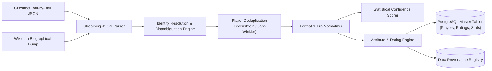

# Data Sources, Licensing & Ingestion Pipeline

**Document Version:** 1.0.0  
**Status:** DRAFT - AWAITING PHASE 0 REVIEW  
**Package:** `@cricket/data-ingestion`  

---

## 1. Data Landscape & Audited Provider Limitations

A realistic cricket simulation game requires accurate historical records, player identities, career statistics, and stadium metadata. However, intellectual property, data licensing, and copyright restrictions mandate a rigorous, legally compliant data strategy.

| Provider / Source | Data Coverage | Licensing Terms | Commercial Redistribution | Usage in Project |
|---|---|---|---|---|
| **Cricsheet.org** | Ball-by-ball JSON/CSV for $>16,000$ international (Tests, ODIs, T20Is) and franchise matches (IPL, BBL, PSL, etc.). | Creative Commons Attribution 4.0 International (**CC-BY 4.0**). | Permitted with explicit attribution. | **PRIMARY FOUNDATION** for match records, player statistics, dismissals, and calibration datasets. |
| **Wikidata & DBpedia** | Structured biographical data: DOB, batting hand, bowling style, debut/retirement dates, national caps. | Creative Commons CC0 / CC-BY-SA. | Permitted with attribution. | **PRIMARY ENRICHMENT** for biographical identities and historical metadata. |
| **Wikimedia Commons** | Photographic assets for historical and contemporary athletes. | Various (Public Domain, CC-BY, CC-BY-SA). | Permitted provided individual image licenses and attribution are stored. | **VERIFIED PHOTO SOURCE**. Requires strict per-image license tracking. |
| **ESPNcricinfo / Cricbuzz** | Proprietary editorial statistics, live scorecards, player images. | Proprietary. Terms of Service strictly forbid scraping, indexing, or commercial redistribution. | **STRICTLY PROHIBITED**. | **EXCLUDED**. No scraping or unauthorized ingestion. |
| **Opta / Sportradar / CricViz** | High-fidelity commercial telemetry (ball tracking, wagon wheels, release speed). | Proprietary B2B Enterprise API contracts (\$25,000–\$150,000+/year). | Permitted only under paid enterprise contracts. | **FUTURE OPTION** when commercial budget is secured. |

### 1.1 Audited Source Coverage & Known Dataset Limitations

To maintain engineering honesty, we establish strict coverage boundaries rather than making unverified claims of global player completeness:

#### Cricsheet Coverage & Limitations:
* **Strengths:** Unrivaled ball-by-ball fidelity for modern international cricket (Men's & Women's T20I, ODI, Test matches from approximately 2004 to present) and major T20 franchise leagues (IPL, BBL, PSL, CPL, Hundred, SA20). Provides exact delivery-by-delivery striker, bowler, extras, and dismissal events.
* **Limitations:** Coverage prior to 2002 is sparse or absent. Historical Test and ODI matches from 1877 to 2000 are not comprehensively represented in ball-by-ball format on Cricsheet.

#### Wikidata / DBpedia Coverage & Limitations:
* **Strengths:** Broad biographical graph coverage covering international and domestic cricketers across all historical eras (DOB, playing role, batting hand, bowling style, debut/retirement years, national teams represented).
* **Limitations:** Wikidata is community-curated; occasional attributes (such as specific bowling style for part-timers or early domestic career dates) are unpopulated or contradictory. It does not contain ball-by-ball performance records.

#### Historical Ingestion & Verification Tier:
* Rather than claiming an arbitrary "2,500+ verified players" before dataset parsing, Phase 2 implements a **verified ingestion pipeline**:
  - **Tier 1 (Modern Validated Cohort):** All international cricketers with complete ball-by-ball match logs on Cricsheet (2004–present). High data confidence (`MEASURED`).
  - **Tier 2 (Historical Legends Cohort):** Pre-2004 international legends whose career records are ingested from verified open historical statistical archives and Wikidata biographical entities. Where granular balls-faced data was never historically recorded, fields remain `NULL`, confidence tiers are badged as `ESTIMATED`, and the rating engine uses Bayesian cohort shrinkage.
  - Actual verified player counts will be published with cryptographic checksums upon completion of Phase 2 ingestion scripts.

---

## 2. Ingestion Pipeline Architecture (ETL)

The data pipeline is designed as an asynchronous, idempotent batch ingestion service driven by BullMQ and Node.js streams.



### 2.1 The 5-Step Ingestion Pipeline:
1. **Raw Ingest & Streaming Parsing:** Streams compressed match JSONs from Cricsheet without loading entire gigabyte archives into memory.
2. **Identity Resolution & Disambiguation:** Resolves player names across varying conventions (e.g. "V Kohli", "Virat Kohli", "V. Kohli") using canonical Cricsheet player IDs and cross-referencing Wikidata entity IDs (`Q...`).
3. **Statistical Aggregation by Format:** Aggregates batting, bowling, and fielding counts strictly segregated by match format (Test, ODI, T20, T10). Formats are **NEVER** merged into a single generic record.
4. **Rating Derivation & Era Calibration:** Applies the mathematical rating pipeline specified in `PLAYER_RATING_SYSTEM.md`, computing era-normalized z-scores and empirical Bayesian shrinkage.
5. **Data Provenance Registration:** Generates an immutable audit record for every imported record.

---

## 3. Strict Data Provenance & Audit Registry

Every statistic and derived rating stored in PostgreSQL retains a link to its origin in the `player_data_sources` audit table:

```sql
CREATE TABLE player_data_sources (
    id UUID PRIMARY KEY DEFAULT gen_random_uuid(),
    player_id UUID NOT NULL REFERENCES players(id) ON DELETE CASCADE,
    source_name VARCHAR(64) NOT NULL, -- 'CRICSHEET', 'WIKIDATA', 'MANUAL_CURATION'
    source_uri TEXT NOT NULL,
    license_type VARCHAR(64) NOT NULL,
    dataset_version VARCHAR(32) NOT NULL,
    ingestion_timestamp TIMESTAMPTZ NOT NULL DEFAULT NOW(),
    verification_status VARCHAR(32) NOT NULL DEFAULT 'AUTOMATED_IMPORT',
    notes TEXT
);
```

---

## 4. Player Photography & Visual Asset Policy

To eliminate legal liabilities regarding player likenesses and copyright infringement:

1. **Strict Licensing Enforcement:** Only images released under Public Domain or Creative Commons licenses (CC-BY, CC-BY-SA) are ingested from Wikimedia Commons. Full photographer attribution and license URLs are stored in `player_photographs`.
2. **Procedural Vector Silhouette Fallback:**
   - When a verified, licensed photograph is unavailable, the UI automatically renders a high-polish, minimalist vector avatar.
   - The avatar utilizes the player's primary national team color palette, primary role emblem (crossed bats for batter, seam ball for pacer, gloves for keeper), and the player's jersey number or initials.
3. **No Unlicensed Scraping Guarantee:** No automated scrapers will target commercial sports websites or social media platforms to download copyrighted headshots.

---

## 5. "No Hallucination" Data Policy

In sports simulation systems, missing historical data presents a significant challenge (e.g. dot-ball percentage or ball-by-ball release speed was not recorded in 1920).

### Mandatory Engineering Rules:
1. **Mark Missing as Unavailable:** If a specific metric is not recorded in historical scorecards (e.g., balls faced by lower-order batters in 1890), the field must remain `NULL`. It must **NEVER** be filled with a fabricated estimate.
2. **Confidence Degradation:** When core metrics are missing, the player's `confidence_score` is lowered proportionately, and the rating engine relies on regularized cohort regression.
3. **No Fabricated Players:** Never invent fictional cricketers to pad the database. If a nation has only 18 documented historical players in our dataset, the database records exactly 18 players.
