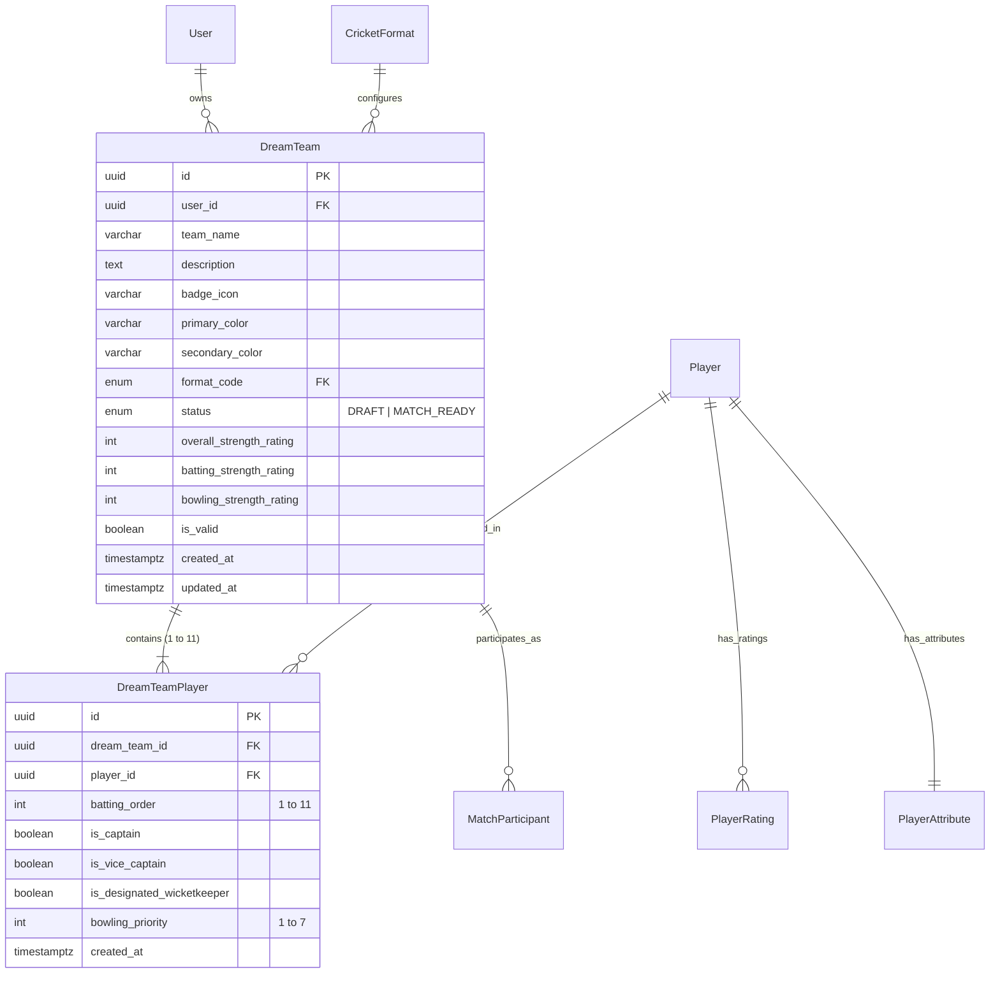

# Dream Team Architecture Specification (Phase 3)

**Document Version:** 1.0.0  
**Phase:** Phase 3 — Dream Team Builder & Squad Analytics  
**Status:** ARCHITECTURAL SPECIFICATION & AUDIT  
**Date:** November 9, 2026  

---

## 1. Executive Summary & Product Objective

The **Dream Team Builder & Squad Analytics** system enables users to construct, customize, analyze, validate, and persist custom playing XIs selected from the verified global cricketer catalogue across historical eras and formats (`T10`, `T20`, `ODI`, `TEST_RED_BALL`, `TEST_PINK_BALL`).

### Non-Negotiable Architectural Principles:
1. **Reuse Existing Foundations:** Zero duplication of player or rating models. The system directly references the verified Phase 2 entities (`Player`, `PlayerRating`, `PlayerAttribute`, `PlayerFormatStatistic`).
2. **Strict Decoupling from Match Engine:** Squad management is strictly decoupled from the Phase 4 simulation engine.
3. **Format-Specific Dynamics:** A Dream XI is created for a specific cricket format. Player ratings, bowling over limits, and analytical dimensions are evaluated strictly according to that format.
4. **Draft vs. Match-Ready Lifecycle:** Users may incrementally assemble and save incomplete drafts (e.g. 6/11 players), but an XI cannot be marked `MATCH_READY` or entered into a match simulation without passing strict squad validation.
5. **Rating Immutability for Matches:** When a Dream Team enters a match in Phase 4, a snapshot of all 11 players' format ratings and attributes is captured into `DreamTeamParticipant` to ensure historical match deterministic reproducibility is never corrupted by subsequent rating engine updates.

---

## 2. Domain Model & Relational Schema Design

The entity relationships leverage the existing PostgreSQL schema with minor schema enhancements:



### 2.1 Database Constraints & Integrity Guarantees
- **Player Uniqueness per Team:** `@@unique([dreamTeamId, playerId])` guarantees a player cannot be selected twice in the same playing XI.
- **Batting Position Uniqueness:** `@@unique([dreamTeamId, battingOrder])` guarantees no two players can share the same batting position.
- **Cascading & Restrict Policies:**
  - Deleting a `DreamTeam` cascades to delete its `DreamTeamPlayer` rows.
  - Deleting a `DreamTeam` does **NOT** delete underlying `Player` records (`onDelete: Restrict`).
  - Deleting a `User` cascades to delete their owned `DreamTeam` records.
- **Team Duplication:** Duplicating a team generates a brand new `DreamTeam` UUID and copies all 11 `DreamTeamPlayer` entries with distinct UUIDs, ensuring independent editing with zero cross-team mutation.

---

## 3. Squad Validation Engine Architecture

The squad validation engine is designed as a standalone, framework-agnostic domain module located in `@cricket/cricket-rules` and validated via Zod schemas in `@cricket/validation`.

### 3.1 Validation Hierarchy & Severities

```text
Validation Result
├── Hard Errors (Block MATCH_READY status & match entry)
│   ├── SQUAD_SIZE_INVALID: Must contain exactly 11 players for match readiness
│   ├── DUPLICATE_PLAYER: Player selected multiple times in squad
│   ├── DUPLICATE_BATTING_ORDER: Batting positions must be 1 to 11 unique
│   ├── MISSING_WICKETKEEPER: At least one designated wicketkeeper required
│   ├── MULTIPLE_WICKETKEEPERS: Only one active wicketkeeper may be designated
│   ├── INSUFFICIENT_BOWLING_RESOURCES: XI cannot legally complete bowling quotas
│   └── MISSING_FORMAT_RATING: Player has no valid rating in selected format
└── Advisory Warnings (Permitted for match entry, flagged in analytics)
    ├── NO_CAPTAIN_DESIGNATED: Squad has no captain selected
    ├── TOP_ORDER_DEFICIT: Fewer than 3 recognized top-order batters
    ├── INSUFFICIENT_SPIN_OPTIONS: No spin bowler available (risk on turning tracks)
    ├── INSUFFICIENT_PACE_OPTIONS: Fewer than 2 pace options (risk on green wickets)
    └── TAIL_TOO_LONG: Batting positions 8–11 have average batting rating < 30
```

### 3.2 Bowling Resource Policy (Quota Math)
Rather than hardcoding arbitrary role strings, the validation engine evaluates actual player bowling attributes and format quotas:
- **T20 / T10 Rules:** Maximum 4 overs per bowler in T20 (2 overs in T10). An XI must contain at least **5 distinct bowling options** capable of bowling (bowling rating $\ge 40$ or recognized bowling style).
- **ODI Rules:** Maximum 10 overs per bowler. Minimum 5 bowlers required.
- **Test Rules:** Unlimited overs per bowler. Minimum 4 frontline bowling options required to sustain multi-day bowling stamina.

---

## 4. Squad Analytics Engine Specification

The squad analytics engine produces deterministic, explainable 0–100 metrics across 8 dimensions derived directly from authentic player attributes:

### 4.1 The 8 Analytical Dimensions
1. **Batting Strength (0–100):**
   $$S_{\text{bat}} = \sum_{i=1}^{11} w_i \cdot \text{PlayerBattingRating}_i$$
   where weights $w_i$ reflect batting order significance:
   $$w = [0.15, 0.15, 0.16, 0.14, 0.12, 0.10, 0.08, 0.04, 0.03, 0.02, 0.01]$$
2. **Pace Threat (0–100):** Top 3 pace bowlers' composite bowling rating, weighted by line & length, seam/swing, and yorker execution:
   $$S_{\text{pace}} = 0.50 \cdot P_1 + 0.30 \cdot P_2 + 0.20 \cdot P_3$$
3. **Spin Threat (0–100):** Top 2 spin bowlers' composite rating, weighted by turn, drift, and variation:
   $$S_{\text{spin}} = 0.65 \cdot S_1 + 0.35 \cdot S_2$$
4. **Bowling Depth (0–100):** Quality and breadth of the 5th, 6th, and 7th bowling options to handle match match-up demands.
5. **Fielding Strength (0–100):** Wicketkeeper glovework ($30\%$) + Outfield catching ($30\%$) + Ground fielding/athleticism ($40\%$).
6. **All-Rounder Balance (0–100):** Number and quality of players possessing dual competencies ($\text{Batting} \ge 60$ and $\text{Bowling} \ge 55$).
7. **Lower-Order Batting Capability (0–100):** Batting technique, power, and resilience of positions 8, 9, 10, and 11.
8. **Overall Squad Balance (0–100):** Harmonic-mean composite ensuring that extreme weakness in any single critical area (e.g. zero spinners or zero pace) realistically penalizes the overall rating.

---

## 5. REST API Architecture (`DreamTeamsModule`)

Base path: `/dream-teams`

| Method | Endpoint | Description | Auth & Security |
|---|---|---|---|
| `POST` | `/dream-teams` | Create new Dream Team (draft or complete XI) | Authenticated, validated via Zod |
| `GET` | `/dream-teams` | List authenticated user's dream teams | User-isolated query (`WHERE user_id = :uid`) |
| `GET` | `/dream-teams/:id` | Get team details with all 11 players, stats & ratings | Ownership verified (403 if unauthorized) |
| `PATCH` | `/dream-teams/:id` | Update team metadata (name, colors, format) | Ownership verified, format change resets ratings |
| `DELETE` | `/dream-teams/:id` | Delete team (cascades players, preserves cricketers) | Ownership verified |
| `POST` | `/dream-teams/:id/duplicate` | Duplicate team with independent records | Transactional clone with `(Copy)` suffix |
| `POST` | `/dream-teams/:id/validate` | Run squad validation engine and return errors/warnings | Returns structured report |
| `POST` | `/dream-teams/:id/players` | Add or replace a player at specific batting position | Unique position/player enforced |
| `DELETE` | `/dream-teams/:id/players/:playerId` | Remove player from team | Leaves slot unassigned |
| `PATCH` | `/dream-teams/:id/batting-order` | Reorder batting order in batch | Transactional swap of batting positions |
| `GET` | `/dream-teams/:id/analytics` | Compute 8-dimension analytics radar breakdown | Calculated on current squad snapshot |

---

## 6. Frontend Interaction & UI Design

Location: `/dream-teams` in `apps/web`

### Editorial Sports Aesthetic:
- **Left Pane (Catalogue & Select):** Reuses the existing `/players` API, with debounced search, role filter, era filter, nationality filter, and instant "Add to XI" action with slot selector.
- **Right Pane (Playing XI Board):**
  - Batting order slots (1 to 11) with drag-and-drop handles and keyboard accessible up/down shift.
  - Role pill, batting/bowling style, format rating pill, and captain/keeper radio buttons.
  - Real-time Validation Banner: Live indicator showing `Draft (X/11)` or `Match Ready (11/11)` with expandable error/warning chips.
  - Real-time Analytics Drawer: Visual radar and metric bars for the 8 analytical dimensions updating on every lineup change.
  - Action Bar: Save Draft, Validate Squad, Duplicate Team, Delete Team.
