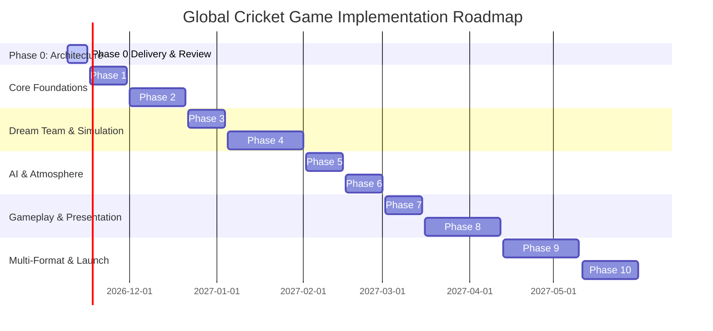

# Implementation Roadmap & Milestone Schedule

**Document Version:** 1.0.0  
**Status:** DRAFT - AWAITING PHASE 0 REVIEW  
**Total Estimated Timeline:** 28 Weeks (Phases 1 through 10)  

---

## 1. Master Milestone Overview

---

## 2. Phase-by-Phase Detailed Specifications

### Phase 1: Core Foundations & Monorepo Setup (Weeks 1–2)
* **Scope & Deliverables:**
  - Initialize pnpm monorepo with Turborepo orchestrator.
  - Scaffold `apps/web` (Next.js 15 App Router, Tailwind CSS, Radix UI) and `apps/api` (NestJS 11).
  - Scaffold core packages: `@cricket/shared-types`, `@cricket/validation`.
  - Set up PostgreSQL 16 & Redis 7 via Docker Compose.
  - Implement Prisma ORM initial schema migrations.
  - Configure Vitest and Playwright CI test harness.
* **Definition of Done (DoD):** Monorepo builds cleanly; database connects; basic healthcheck endpoint responds; CI pipeline passes with 100% green tests.

### Phase 2: Verified Player Database & Ingestion Engine (Weeks 3–5)
* **Scope & Deliverables:**
  - Build `@cricket/data-ingestion` package to stream and parse Cricsheet JSON/CSV archives and Wikidata dumps.
  - Implement identity disambiguation, deduplication, and provenance audit logging.
  - Build `@cricket/player-ratings` engine: 4-layer architecture (Raw Stats -> Era Adjusted Metrics -> Bayesian Shrinkage -> 0–100 Attributes).
  - Execute verified ingestion pipeline: Ingest all modern international & franchise cricketers with complete Cricsheet logs (Tier 1), plus verified historical legends cohort cross-referenced with Wikidata (Tier 2).
  - Build REST APIs for player search, filtering, and profile retrieval.
* **Definition of Done:** Zero fabricated player records; all imported records link to verified provenance; verified player count and checksums published; sub-50ms search query response times.

### Phase 3: Dream Team Builder & Squad Analytics (Weeks 6–7)
* **Scope & Deliverables:**
  - Develop dual-pane Dream Team UI in `apps/web`.
  - Implement interactive roster drag-and-drop batting order (1–11).
  - Real-time squad validation rules: Designated keeper, minimum bowling resources, batting depth.
  - Team analytics radar chart (Pace threat, spin threat, batting balance).
  - Save, edit, and duplicate Dream Teams.
* **Definition of Done:** Invalid rosters cannot be submitted; valid lineups persist to PostgreSQL; users can save multiple dream teams.

### Phase 4: Core Cricket Simulation Engine - T20 MVP (Weeks 8–11)
* **Scope & Deliverables:**
  - Implement `@cricket/simulation-engine` as a pure TypeScript package.
  - Architect underlying `MatchState` domain models to natively support multi-innings, multi-day Test sessions, declarations, follow-ons, and pitch deterioration.
  - Build the 10-Stage Delivery Pipeline (Softmax probability vector, SplitMix64 PRNG).
  - Implement comprehensive T20 cricket rules (Powerplays, bowler quotas, striker rotation, extras, free hits, dismissals).
  - Build deterministic replay validator (`simulation_version`, `ruleset_version`, `rating_version`, and $H_0$ initial state hash).
  - Run initial 10,000-match Monte Carlo calibration tests.
* **Definition of Done:** Engine simulates a full 40-over T20 match in $< 20\text{ ms}$; outputs stay strictly within historical calibration envelopes; replay matches 1:1.

### Phase 5: AI Opponent Generator & Tactical Captaincy (Weeks 12–13)
* **Scope & Deliverables:**
  - Implement `@cricket/ai-opponent`: Squad archetype selection, counter-picking algorithms, pitch suitability scoring.
  - Implement `@cricket/ai-captain`: Dynamic bowling quota management, field setting shifts, chase aggression.
  - Implement EASY, MEDIUM, and HARD difficulty policies.
* **Definition of Done:** Hard AI exploits user weaknesses without altering simulation outcome probabilities; zero cheat mechanics.

### Phase 6: Stadiums, Pitch & Environment Engine (Weeks 14–15)
* **Scope & Deliverables:**
  - Seed global cricket stadium catalogue with authentic boundary dimensions and geographic metadata.
  - Implement 8 pitch profiles (Green, Turning, Dusty, Flat, etc.) and atmospheric modifiers (humidity, cloud swing, dew factor).
  - Pitch deterioration model across cumulative overs.
* **Definition of Done:** Green pitch demonstrates statistically significant increase in seam movement; turning pitch amplifies spin wickets.

### Phase 7: Hybrid Gameplay System (Weeks 16–17)
* **Scope & Deliverables:**
  - Build interactive coin-toss presentation.
  - Implement seamless hybrid switching: Macro Phase-based simulation vs. Ball-by-Ball tactical intervention.
  - Tactical decision controls: Batter intent, bowler line/length, field presets.
  - Mid-match save, resume, and checkpoint synchronization.
* **Definition of Done:** User can switch back and forth between ball-by-ball and phase simulation without state corruption or recalculation.

### Phase 8: Visual Match Presentation - PixiJS 2D Engine (Weeks 18–21)
* **Scope & Deliverables:**
  - Integrate PixiJS v8 2D WebGL/WebGPU top-down field canvas inside Next.js.
  - Animate ball release, pitch bounce, bat strike trajectory, and boundary celebrations at 60 FPS.
  - Render 11 dynamic fielder positions and smooth fielding intercept vectors.
  - Real-time wagon-wheel overlays and broadcast telemetry HUD.
  - Mobile touch responsive viewports.
* **Definition of Done:** Constant 60 FPS rendering; crisp visual presentation; zero visual lag impacting underlying simulation logic.

### Phase 9: Multi-Format Expansion (Weeks 22–25)
* **Scope & Deliverables:**
  - Expand engine rulesets to cover T10, ODI, Test Red Ball, and Test Pink Ball (Day/Night).
  - Test session structure (3 daily sessions, intervals, 90 overs/day, 80-over new ball).
  - Declarations, follow-ons, nightwatchman tactics, and draw/tie outcomes.
  - Pink ball twilight visibility changes and floodlight mechanics.
* **Definition of Done:** Full 5-day Test match simulation executes with authentic session pacing and pitch deterioration.

### Phase 10: Quality Assurance, Hardening & Launch (Weeks 26–28)
* **Scope & Deliverables:**
  - Full Monte Carlo calibration across all 5 formats (50,000 simulated matches).
  - Security audit: Rate limiting, input validation, authenticated session hardening.
  - Browser compatibility testing (Chrome, Safari, Firefox, Edge, iOS Safari, Android Chrome).
  - Production deployment on Docker / Kubernetes / Edge CDN.
* **Definition of Done:** Zero Sev-1 bugs; certified match scorecard generation; public release readiness.
