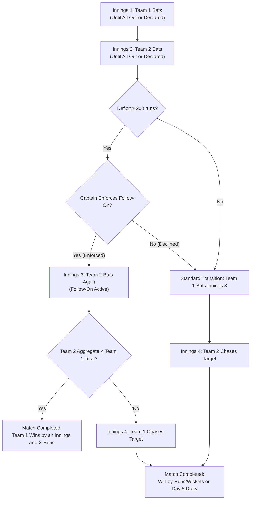

# PHASE 8.1: TEST CRICKET ENGINE VERIFICATION REPORT
## Multi-Innings Architecture, Session Scheduling, Ball Wear, & Invariant Preservation

**Audit Date:** 10 November 2026  
**Subject Engine:** `@cricket/simulation-engine` (`sim-1.0.0`)  
**Verified Formats:** `TEST_RED_BALL` (`rules-test-icc-2026.1`), `TEST_PINK_BALL` (`rules-test-pink-ball-icc-2026.1`)  

---

## 1. TEST MATCH LIFECYCLE & INNINGS TRANSITIONS

Unlike limited-overs cricket, Test matches span up to four distinct innings and five scheduled days. The simulation engine coordinates these transitions through a deterministic state machine:

---

## 2. SESSION SCHEDULING & TIME ACCOUNTING

Test cricket matches do not use an unconditional hard cap on overs. Play is structured around five scheduled days of three sessions each:

### 2.1 Schedule Configurations
- **Scheduled Days:** 5 days (maximum 90 overs per day = 450 scheduled overs).
- **Red Ball Schedule:**
  - Session 1: Morning (120 min, 30 overs) $\to$ **Lunch** (40 min).
  - Session 2: Afternoon (120 min, 30 overs) $\to$ **Tea** (20 min).
  - Session 3: Evening (120 min, 30 overs) $\to$ **Stumps / Close of Play**.
- **Pink Ball (Day/Night) Schedule:**
  - Session 1: Afternoon (120 min, 30 overs) $\to$ **Tea** (20 min).
  - Session 2: Twilight (120 min, 30 overs) $\to$ **Dinner** (40 min).
  - Session 3: Night under floodlights (120 min, 30 overs) $\to$ **Stumps**.

### 2.2 Time & Permitted Additional Time (ICC Clause 16.2.2)
- Over pacing: approximately 4.0 minutes per over (15 overs per hour).
- Permitted additional time: If 9 wickets are down when a session or day's scheduled overs are reached, play can be extended by up to 30 minutes (or 8 additional overs) to allow the fielding side an opportunity to take the final wicket.
- When Day 5 concludes without a winning result, the match status resolves to `COMPLETED` with `isDraw: true` and `summary: "Match drawn (Day 5 overs concluded)"`.

---

## 3. FOLLOW-ON & NEW-BALL CAPTAINCY DECISIONS

### 3.1 Follow-On Mechanics (MCC Law 14)
1. **Deficit Evaluation:** At the end of Innings 2, deficit = `Innings 1 Total - Innings 2 Total`.
2. **Eligibility:** If deficit $\ge 200$, `isFollowOnEligible = true`.
3. **Optional Execution:**
   - If user/tactical action sets `enforceFollowOn === true`, Team 2 is made to follow on and bats Innings 3.
   - If `enforceFollowOn === false`, follow-on is declined; Team 1 bats again to build an unassailable target.
   - If `enforceFollowOn === undefined` (AI captain): AI enforces follow-on if lead $\ge 250$ runs or if bowlers bowled $< 90$ overs; otherwise AI declines follow-on to rest bowlers.

### 3.2 New Ball Mechanics (ICC Test Clause 4.3)
1. **Availability:** When `oversSinceNewBall >= 80`, `isNewBallAvailable = true`.
2. **Tactical Delay vs. Claim:**
   - Taking the new ball is not automatic. If spinners are operating effectively on a deteriorating Day 4/5 surface, the fielding captain may choose `takeNewBall = false` to retain the worn ball (`ballWearIndex` preserved).
   - Once pacers are reintroduced or the captain chooses `takeNewBall = true`, `oversSinceNewBall` resets to 0 and `ballWearIndex` resets to 0.05.

---

## 4. VERIFICATION EVIDENCE

The complete Test engine lifecycle was verified in automated vitest test suites:
- `tests/phase-8-1-engine-audit.test.ts`:
  - `implements Follow-On as an optional captain decision (enforced vs declined)`: **PASS**
  - `implements New Ball as an optional captain decision after 80 overs`: **PASS**
  - `implements Captain Declaration and innings termination`: **PASS**
  - `terminates 5-day Test in a Draw when overs expire without result`: **PASS**
  - `simulates complete Test Red Ball match and verifies multi-innings accounting`: **PASS**
  - `simulates complete Test Pink Ball match and verifies day-night accounting`: **PASS**
- `tests/multiformat.test.ts`:
  - `simulates a Test Red Ball match across multiple innings with session and day accounting`: **PASS**
  - `simulates a Test Pink Ball match with day-night condition tracking`: **PASS**

All domain invariants (wickets $\le 10$, legal balls $\le 6$, run conservation, scorecard reconciliation) remained 100% valid at every delivery transition.
