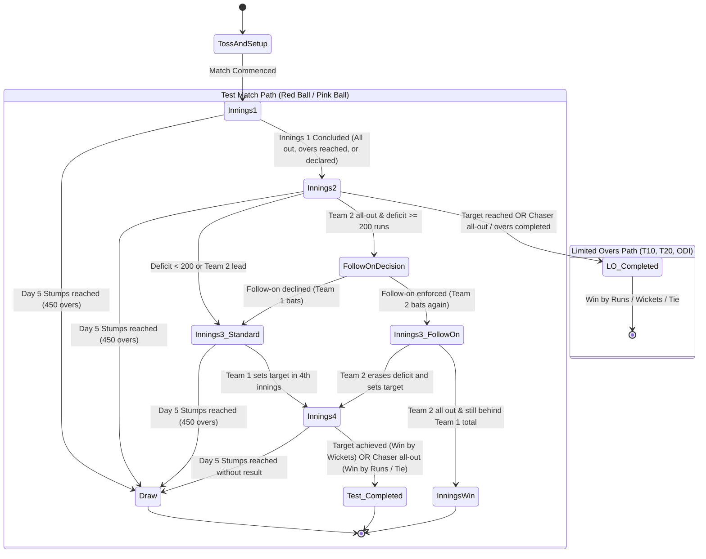

# PHASE 8 MULTI-FORMAT CRICKET ENGINE ARCHITECTURE
## Unified Deterministic State Machine for T10, T20, ODI, Test Red Ball & Test Pink Ball

**Document Status:** Approved Architecture Reference  
**Version:** 2.0.0  
**Triad Alignment:** Simulation `sim-1.0.0` | Ruleset `rules-multi-format-icc-2026.1` | Rating `rate-1.0.0`  
**Reference Date:** 10 November 2026  

---

## 1. ARCHITECTURAL PRINCIPLES

1. **Single Source of Truth:** All 5 formats share the exact same underlying deterministic delivery simulation pipeline, physics models, SplitMix64 PRNG, and state verification. No duplicate simulation engines exist.
2. **Format-Driven State Transition:** Rulesets declare constraints (max overs, bowler quotas, powerplay tiers, day/session limits, follow-on thresholds, declaration rules). The delivery transition function `stepDelivery()` queries these rulesets dynamically to drive innings transitions, session advancement, and match termination.
3. **Multi-Innings Finite State Machine:** Supports $N \in [1, 4]$ innings:
   - Limited Overs (T10, T20, ODI): Exactly 2 innings.
   - Test Matches (Red Ball & Pink Ball): Up to 4 innings with follow-on branching, voluntary declaration, and 5-day draw resolution.
4. **Deterministic Replay Guarantee:** Given the same initial configuration, format, and random seed $\text{Seed}_0$, any match across any format replays with 100% bit-exact parity across all platforms and devices.

---

## 2. FORMAT SPECIFICATION MATRIX

| Dimension | T10 | T20 | ODI | TEST_RED_BALL | TEST_PINK_BALL |
| :--- | :--- | :--- | :--- | :--- | :--- |
| **Max Overs / Innings** | 10 | 20 | 50 | Unlimited ($\le 450$ match total) | Unlimited ($\le 450$ match total) |
| **Bowler Over Quota** | 2 | 4 | 10 | Unlimited (no consecutive overs)| Unlimited (no consecutive overs)|
| **Innings Per Team** | 1 | 1 | 1 | 2 | 2 |
| **Scheduled Match Days**| 1 | 1 | 1 | 5 days | 5 days |
| **Scheduled Overs / Day**| N/A | N/A | N/A | 90 overs / day | 90 overs / day |
| **Sessions Per Day** | 1 | 1 | 1 | 3 (Morning, Afternoon, Evening)| 3 (Afternoon, Twilight, Night) |
| **Session Overs** | N/A | N/A | N/A | 30 overs / session | 30 overs / session |
| **Intervals** | Mid-innings break (10m) | Mid-innings break (20m) | Mid-innings break (45m) | Lunch (40m), Tea (20m), Stumps | Tea (20m), Dinner (40m), Stumps |
| **Powerplay Structure** | Overs 1–3 (P1: 2 outside)| Overs 1–6 (P1: 2 outside)| P1 (1–10: 2), P2 (11–40: 4), P3 (41–50: 5) | None (up to 9 outside circle) | None (up to 9 outside circle) |
| **Free Hit on No-Ball** | Yes (Front Foot) | Yes (Front Foot) | Yes (Front Foot) | No | No |
| **Follow-On Threshold** | N/A | N/A | N/A | 200 runs deficit | 200 runs deficit |
| **New Ball Availability**| N/A | N/A | N/A | Every 80 overs | Every 80 overs |
| **Ball Wear Dynamics** | High wear / ball: +0.015 | Medium wear / ball: +0.008 | Low wear / ball: +0.003 | Gradual: +0.002, resets at 80 ov | Gradual: +0.002, twilight swing |
| **Possible Match Results**| Win (Runs/Wickets), Tie | Win (Runs/Wickets), Tie | Win (Runs/Wickets), Tie | Win, Win by Innings, Tie, Draw | Win, Win by Innings, Tie, Draw |

---

## 3. FINITE STATE MACHINE (FSM) & INNINGS PROGRESSION

---

## 4. TEST CRICKET SPECIFIC MECHANISMS

### 4.1 Daily Session and Day Progression
- Each test day consists of exactly 3 sessions of 30 overs (total 90 overs per day).
- When `sessionOversBowled` reaches 30:
  - If `currentSessionNumber < 3`: increment session (`currentSessionNumber++`), reset `sessionOversBowled = 0`.
  - If `currentSessionNumber === 3`: advance day (`currentDayNumber++`), reset `currentSessionNumber = 1`, reset `sessionOversBowled = 0`.
- If `currentDayNumber > 5` or total match overs $\ge 450$ before a definitive result is reached, the match transitions to status `COMPLETED` with `isDraw: true`.

### 4.2 New Ball at 80 Overs
- In Test cricket, a bowling captain is entitled to a new ball every 80 overs (`oversSinceNewBall >= 80`).
- When the new ball is taken:
  - `oversSinceNewBall` resets to 0.
  - `ballWearIndex` resets to 0.05.
  - Pace bowlers gain heightened seam and swing deltas in `calculateEnvironmentalDeltas()`.

### 4.3 Pitch Degradation Over 5 Days
- Unlike limited overs where pitch wear is modest (0.05–0.15), Test pitch wear accumulates progressively over 5 days:
  - Day 1: Fresh pitch (0.00–0.20 wear), favorable to seamers.
  - Day 2–3: Prime batting conditions (0.20–0.50 wear).
  - Day 4–5: Deteriorating pitch (0.50–1.00 wear, surface cracks opening), causing variable bounce, sharp spin, and elevated dismissal rates for spinners.

### 4.4 Follow-On Rule (MCC Law 14)
- At the conclusion of Innings 2:
  $$\text{Deficit} = \text{Runs}_{\text{Innings 1}} - \text{Runs}_{\text{Innings 2}}$$
- If $\text{Deficit} \ge 200$, the fielding captain (Team 1) evaluates follow-on.
- The AI captain enforces the follow-on if $\text{Deficit} \ge 220$ and bowler fatigue / overs bowled allow it.

### 4.5 Declarations (MCC Law 15)
- In Test cricket, an innings can be declared closed before all 10 wickets fall.
- The AI captain evaluates declaration in Innings 1 or 3 when:
  - Total lead exceeds 350 runs, or
  - Team has reached a dominant score (e.g., 500+ in Innings 1) with time remaining to bowl out the opponent.

---

## 5. FORMAT-SPECIFIC AI CAPTAINCY TACTICS

1. **T10:**
   - Batting Intent: Highly aggressive (`AGGRESSIVE` 60%, `MAXIMUM_POWER` 40%). Wickets are expendable.
   - Bowling: Yorker-heavy execution from ball 1.
2. **T20:**
   - Powerplay exploitation, middle overs strike-rotation with boundary hunting, death over maximal slogging.
3. **ODI:**
   - Phase 1 (1–10): Calculated aggression against the new ball.
   - Phase 2 (11–40): Strike rotation (singles, doubles) with low dismissal risk.
   - Phase 3 (41–50): Progressive acceleration to death overs.
4. **Test Matches:**
   - Focus on survival, leaves, defense (`DEFEND` 50%, `ROTATE_STRIKE` 35%, `AGGRESSIVE` 15%).
   - Aggression increases only when setting up a declaration.
   - Fourth innings survival: If chasing target is statistically unattainable, batter intent switches strictly to `DEFEND` to salvage a draw.
