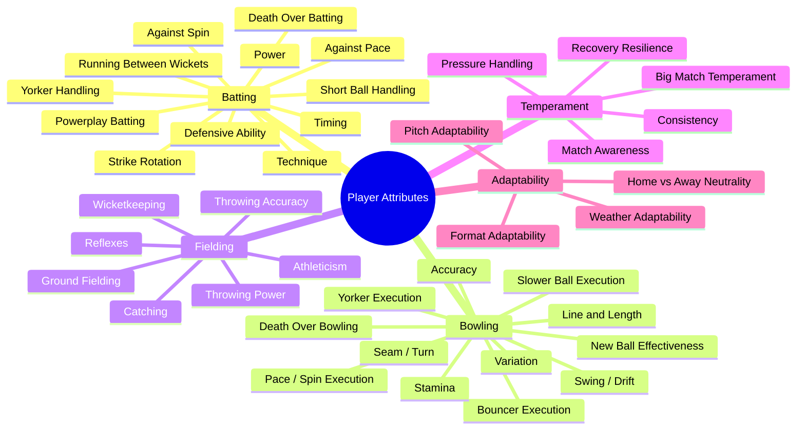
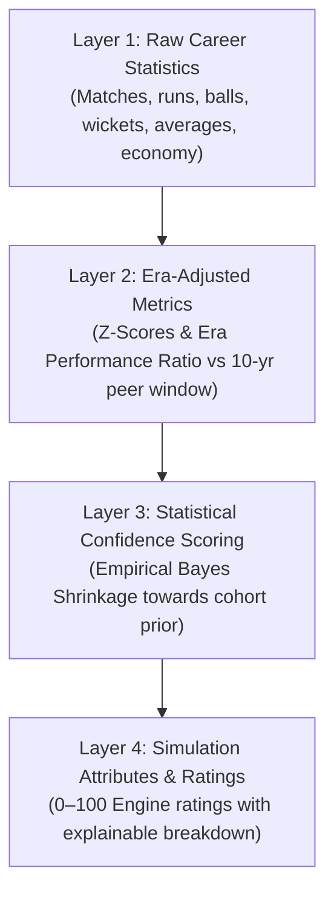

# Player Rating & Attribute Engine Specification

**Document Version:** 1.0.0  
**Status:** DRAFT - AWAITING PHASE 0 REVIEW  
**Package:** `@cricket/player-ratings`  
**Scale:** 0 to 100 Integer Ratings (Calibrated against global historical cohorts)  

---

## 1. Multi-Dimensional Attribute Taxonomy

Every cricketer in the database is modeled across **five core categories** comprising granular, measurable sub-attributes scored on a deterministic 0–100 scale.



### 1.1 Category Definitions & Weightings

#### Category A: Batting (Sub-Attributes 0–100)
1. **Technique:** Head position, balance, footwork alignment against orthodox bowling.
2. **Timing:** Sweet-spot contact efficiency, shot deceleration/acceleration.
3. **Power:** Raw boundary-clearing capability and exit velocity.
4. **Strike Rotation:** Ability to drop, push, and score singles against defensive field placements.
5. **Defensive Ability:** Resistance against wicket-taking balls, forward/backward defensive solidity.
6. **Against Pace:** Ability to handle deliveries $>135\text{ km/h}$.
7. **Against Spin:** Ability to read trajectory, flight, turn, and use feet or sweep against spinners.
8. **Short-Ball Handling:** Proficiency in hooking, pulling, and ducking bouncers.
9. **Yorker Handling:** Digging out toe-crushers and keeping low full deliveries out.
10. **Death-Over Batting:** Ability to strike boundaries against defensive bowling and funky fields.
11. **Powerplay Batting:** Exploitation of inner ring field restrictions.
12. **Running Between Wickets:** Speed, acceleration, turn speed, and calling clarity between wickets.

#### Category B: Bowling (Sub-Attributes 0–100)
1. **Line & Length Control:** Repeatability of delivery pitch landing coordinates.
2. **Pace / Spin Execution:** Peak velocity (for fast bowlers) or raw revolutions per minute (RPM for spinners).
3. **Swing / Drift:** Aerodynamic movement through the air (conventional and reverse swing / flight drift).
4. **Seam / Turn:** Deviation off the pitch surface upon bouncing.
5. **Accuracy:** Minimizing unintended extras (wides, half-volleys, long-hops).
6. **Variation:** Mastery of alternate deliveries (knuckle ball, back-of-the-hand slower ball, googly, carrom ball, slider).
7. **Yorker Execution:** Precision in executing blockhole deliveries under pressure.
8. **Slower-Ball Execution:** Deception and arm-speed retention on slower deliveries.
9. **Bouncer Execution:** Steep bounce generation targeted at the batter's helmet/ribs.
10. **Death-Over Bowling:** Execution of boundary-denial strategies in overs 16–20 (or 8–10 in T10).
11. **New-Ball Effectiveness:** Taking wickets and creating false shots with the brand-new ball.
12. **Stamina:** Resistance to pace decay and accuracy loss over extended multi-over spells (crucial for Test cricket).

#### Category C: Fielding (Sub-Attributes 0–100)
1. **Catching:** Clean hand-eye coordination for catching in the slips and outfield.
2. **Reflexes:** Reaction time at close-in catching positions (slips, short leg, silly point).
3. **Ground Fielding:** Pick-and-throw speed, sliding, boundary-rope boundary-saving dives.
4. **Throwing Accuracy:** Direct-hit frequency from 30+ meters.
5. **Throwing Power:** Arm strength and throw velocity from boundary fence to wicketkeeper.
6. **Wicketkeeping:** Footwork, glovework, stumping speed, handling deliveries down leg side.
7. **Athleticism:** Overall speed, sprint recovery, and agility.

#### Category D: Temperament (Sub-Attributes 0–100)
1. **Pressure Handling:** Performance modifier in high-run-rate chases, knockout matches, and critical wickets.
2. **Consistency:** Low standard deviation in match-to-match performance outputs.
3. **Match Awareness:** Contextual risk calibration (e.g. knowing when to block out a session vs attack).
4. **Big-Match Temperament:** Historical multiplier in finals and rivalry matches.
5. **Recovery Resilience:** Ability to reset after being hit for consecutive boundaries or dropped catches.

#### Category E: Adaptability (Sub-Attributes 0–100)
1. **Format Adaptability:** Seamlessness in transitioning between Test, ODI, and T20 approaches.
2. **Pitch Adaptability:** Maintaining baseline performance across alien pitch surfaces (e.g. subcontinent batters on bouncy Perth wickets).
3. **Weather Adaptability:** Performance in humid, overcast, windy, or extreme heat conditions.
4. **Home vs. Away Neutrality:** Performance differential when playing outside domestic home conditions.

---

## 2. Format-Specific Rating Decoupling

A player does not possess a single static rating. Every player has **independent composite ratings** calculated for each cricket format:

```text
Player Overall = f(Format)
├── T10 Rating:        Weighted heavily on Power, Yorker Execution, Death-Over Execution, Strike Rotation.
├── T20 Rating:        Balanced across Powerplay, Boundary Strike Rate, Dot-Ball Economy, Variations.
├── ODI Rating:        Combines Strike Rotation, Middle-Over Consolidation, Bowling Stamina, 10-Over Spells.
├── Test Red Ball:     Prioritizes Defensive Technique, Line/Length Repeatability, Stamina, Slip Catching.
└── Test Pink Ball:    Test Red Ball baseline + Twilight Adjustment + Swing/Seam Modifier under floodlights.
```

### Illustrative Rating Separation:
* **Sir Donald Bradman:** Test: **99** | ODI (Theoretical / Historical Era Normal): **95** | T20: **84**
* **Chris Gayle:** Test: **86** | ODI: **89** | T20: **98** | T10: **97**
* **James Anderson:** Test Red Ball: **96** | Test Pink Ball: **98** | ODI: **83** | T20: **72**

---

## 3. Four-Layer Data Architecture & Historical Normalization

To ensure data integrity, historical realism, and complete transparency, player performance is partitioned into **four distinct, strictly decoupled layers**:



### 3.1 Layer 1: Raw Career Statistics (`player_format_statistics`)
- Contains strictly unadjusted, authentic historical records sourced directly from validated match scorecards.
- Tracks matches, innings, runs, highest score, not outs, batting average, strike rate, balls bowled, wickets, economy, bowling average, catches, and stumpings.
- Kept segregated by format (never combined into a generic aggregate).

### 3.2 Layer 2: Era-Adjusted Metrics (`player_era_metrics`)
Historical players cannot be evaluated using raw modern statistics without bias:
- Pre-1970s Test matches were played on **uncovered pitches** where rain turned surfaces into treacherous "sticky wickets."
- Modern white-ball cricket features **two new balls**, field restrictions, heavy bats, and standardized boundaries.

#### Era Baseline Brackets:
1. **Golden Age (1877–1914):** Low scoring rates, high bowling dominance, sticky wickets.
2. **Interwar Period (1919–1939):** Uncovered wickets, rise of legendary batting masters.
3. **Post-War Era (1946–1970):** Defensive attrition, introduction of covered pitches late in period.
4. **Pace Revolution (1971–1991):** Rise of four-prong West Indian fast bowling, introduction of helmets and early ODIs.
5. **Globalized Era (1992–2007):** Modern protective equipment, reverse swing masters, single white ball ODI rules.
6. **T20 Revolution (2008–2020):** 360-degree batting, franchise leagues, two new white balls in ODIs.
7. **Contemporary Analytics Era (2021–Present):** Data-driven matchup bowling, dynamic boundary dimensions.

#### The Era Performance Ratio (EPR) & Z-Score Transform
To calculate an era-normalized metric $M_{\text{norm}}$:
$$M_{\text{norm}} = \mu_{\text{modern\_benchmark}} + \left( \frac{M_{\text{raw}} - \mu_{\text{era\_peer}}}{\sigma_{\text{era\_peer}}} \right) \cdot \sigma_{\text{modern\_benchmark}}$$

Where:
* $M_{\text{raw}}$ is the player's actual recorded career metric (e.g. batting average).
* $\mu_{\text{era\_peer}}$ is the mean metric of top-tier contemporary peers in that specific 10-year rolling window.
* $\sigma_{\text{era\_peer}}$ is the standard deviation among contemporary peers.
* $\mu_{\text{modern\_benchmark}}, \sigma_{\text{modern\_benchmark}}$ represent the standardized calibration cohort.

This ensures that a player who averaged 45 in an era where the peer mean was 28 is properly recognized as an elite 90+ rated batter, rather than rated as mediocre against modern inflated averages.

---

## 4. Layer 3: Statistical Confidence Scoring & Shrinkage

To prevent statistical distortions where a player who played only 3 matches with a freak average of 80 is rated higher than a legend who played 100 matches, we introduce **Empirical Bayes Shrinkage**:

$$\text{Attribute}_{\text{effective}} = C \cdot \text{Attribute}_{\text{observed}} + (1 - C) \cdot \mu_{\text{cohort\_prior}}$$

### Confidence Formulation:
$$C = \frac{N_{\text{innings}}}{N_{\text{innings}} + K_{\text{format}}}$$

Where $K_{\text{format}}$ is the shrinkage dampening constant:
- Test Cricket: $K = 25$ innings.
- ODI Cricket: $K = 35$ innings.
- T20 / T10: $K = 40$ innings.

### Confidence Tiers:
* **MEASURED ($C \ge 0.85$):** Robust sample size ($N \ge 50$ innings). High statistical fidelity.
* **ESTIMATED ($0.50 \le C < 0.85$):** Moderate sample size ($15 \le N < 50$). Regressed moderately towards peer mean.
* **IMPUTED ($C < 0.50$):** Limited historical sample ($N < 15$). Heavily regularized towards cohort baseline with explicit UI indicator.

---

## 5. Layer 4: Simulation Ratings, Explainability & Versioning

### 5.1 Explainable Rating Breakdown
Every composite rating presented in the UI provides a transparent inspector modal displaying:
1. **Raw Metric:** (e.g., Test Batting Average: `58.45`).
2. **Era Context:** (Era: `1971–1991 Pace Revolution`, Peer Mean: `31.20`, Z-Score: `+2.84`).
3. **Sample Confidence:** (Innings: `118`, Confidence: `0.98 - MEASURED`).
4. **Final Derived Attribute:** (`Batting Technique: 96`, `Against Pace: 97`).

### 5.2 Rating Engine Versioning (`rating_version`)
- All attribute calculation formulas, era peer coefficients, and shrinkage constants are versioned semantically (e.g., `rate-1.0.0`).
- Historical matches retain the `rating_version` active at match creation time to guarantee deterministic replayability without rating drift.
