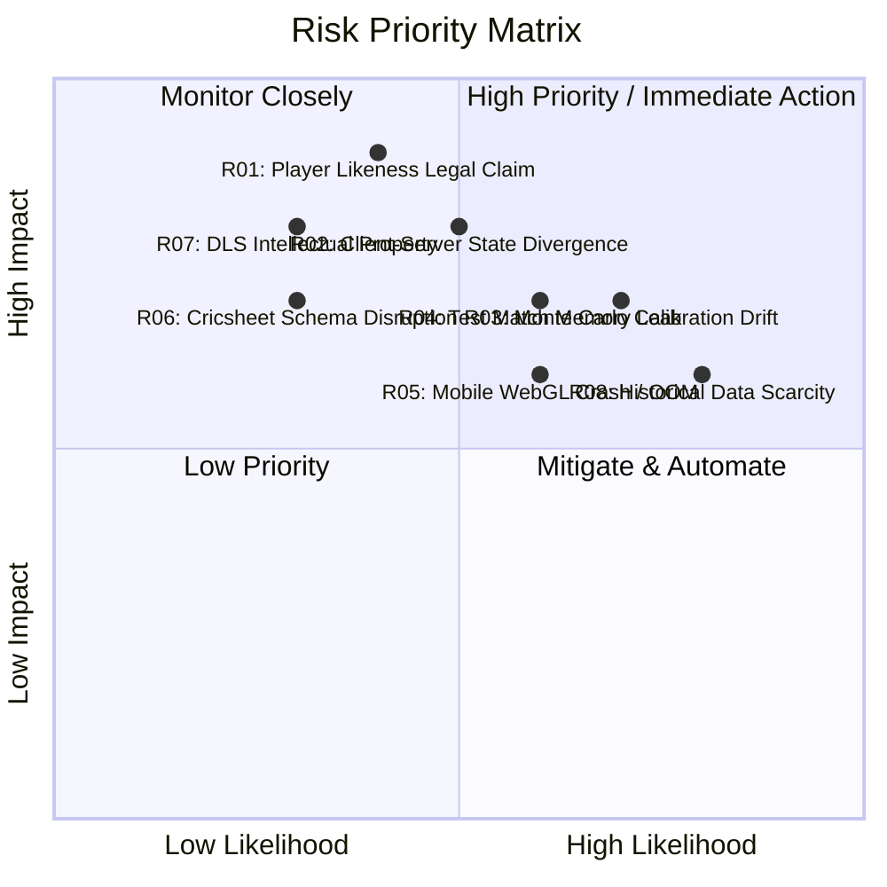

# Project Risk Register & Mitigation Strategies

**Document Version:** 1.0.0  
**Status:** DRAFT - AWAITING PHASE 0 REVIEW  
**Risk Scoring:** Likelihood (1–5) $\times$ Impact (1–5) = Risk Score (1–25)  

---

## 1. Risk Matrix Overview

---

## 2. Detailed Risk Register

| Risk ID | Category | Risk Description | Pre-Mit L | Pre-Mit I | Score | Mitigation Strategy | Contingency Plan | Residual Score | Owner |
|---|---|---|---|---|---|---|---|---|---|
| **R01** | Legal / IP | Intellectual property or publicity right claims regarding real cricketer names, likenesses, and photographs. | 2 | 5 | **10** | Facts, names, and sports statistics are non-copyrightable public domain facts under international sports law (e.g., *CBC v. MLBAM* precedent). Ingest images exclusively under verified CC-BY / Public Domain licenses. | Procedural vector silhouette and monogram badge fallback system replaces photographs instantly with zero downtime. | 4 (Low) | Legal / Architect |
| **R02** | Technical | Client-side simulation state diverges from server state during fast-forward phase simulation or packet drops. | 3 | 4 | **12** | Implement pure deterministic PRNG (SplitMix64) and seed derivation hierarchy. Engine logic is 100% shared across client and server via isomorphic package. | Server re-runs seed from initial checkpoint. If state hash diverges, server state is pushed to client as authoritative. | 3 (Low) | Simulation Lead |
| **R03** | Simulation | Base probability tuning produces unrealistic match scores (e.g., constant 250+ T20 totals or 80-all-out collapses). | 4 | 4 | **16** | Automated CI pipeline executes 10,000-match Monte Carlo batches per format, enforcing strict tolerance envelopes against historical ICC datasets. | Automatic fallback to baseline calibrated probability weights if tuned weights fail verification. | 4 (Low) | Simulation Lead |
| **R04** | Performance | Multi-day Test matches with $>2,500$ deliveries cause JavaScript memory bloat and garbage collection stutters in browser. | 3 | 4 | **12** | Immutable state snapshots store only delta updates. Historical ball telemetry is streamed to IndexedDB / backend, keeping active V8 memory footprint under 25 MB. | Periodic checkpoint pruning; clear completed session visual sprites from PixiJS scene graph. | 3 (Low) | Frontend Lead |
| **R05** | Performance | WebGL canvas context loss or high battery drain on budget mobile browsers during live 2D animations. | 4 | 3 | **12** | PixiJS v8 automatic canvas fallback; object pooling for ball and player sprites; frame-rate throttling to 30 FPS when battery saver is active. | Lightweight 2D canvas fallback without complex particle effects. | 4 (Low) | Frontend Lead |
| **R06** | Data Pipeline | Structural changes or naming anomalies in third-party open datasets (Cricsheet JSON updates) break ingestion ETL. | 2 | 4 | **8** | Strict Zod schema validation at ingestion boundary; versioned staging tables; automated regression alerts on parser failures. | Manual curation interface for resolving conflicting player identities. | 2 (Low) | Data Engineer |
| **R07** | Legal / Rules | Implementing proprietary Duckworth-Lewis-Stern (DLS) algorithms triggers patent or copyright infringement claims. | 2 | 4 | **8** | Use standard ICC target calculations or open-source VJD (V. Jayadevan) mathematical curve algorithms, properly cited as a simulation scoring method. | Maintain clear parameter abstraction so calculation module can be swapped seamlessly. | 2 (Low) | Architect |
| **R08** | Data Accuracy | Historical eras (1890–1930) lack modern telemetry metrics (balls faced, wagon wheels, dot ball tracking). | 4 | 3 | **12** | Enforce "No Hallucination" rule: leave unavailable fields NULL, lower confidence scores, and use Bayesian cohort shrinkage for missing attributes. | Clearly badge historical profiles with "IMPUTED / ESTIMATED" confidence tiers in the UI. | 3 (Low) | Data Engineer |
| **R09** | Game Balance | AI HARD difficulty feels unfair or frustrating, or EASY difficulty feels trivial. | 3 | 3 | **9** | Enforce fairness guarantee: difficulty strictly modulates the AI's tactical policy choice, never tweaking physics or delivery roll probabilities. | Provide post-match AI decision transparency log showing why the AI chose a specific tactic. | 3 (Low) | AI Engineer |
| **R10** | Security | Malicious users manipulate client-side WebSocket payloads to submit fraudulent high scores or fabricated wins. | 3 | 4 | **12** | Server-side cryptographic seed verification re-runs player match logs before certifying official match scorecards or leaderboard entries. | Discard unverified client match results; mark match as UNVERIFIED. | 2 (Low) | Backend Lead |
