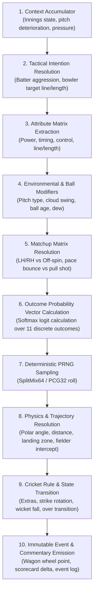
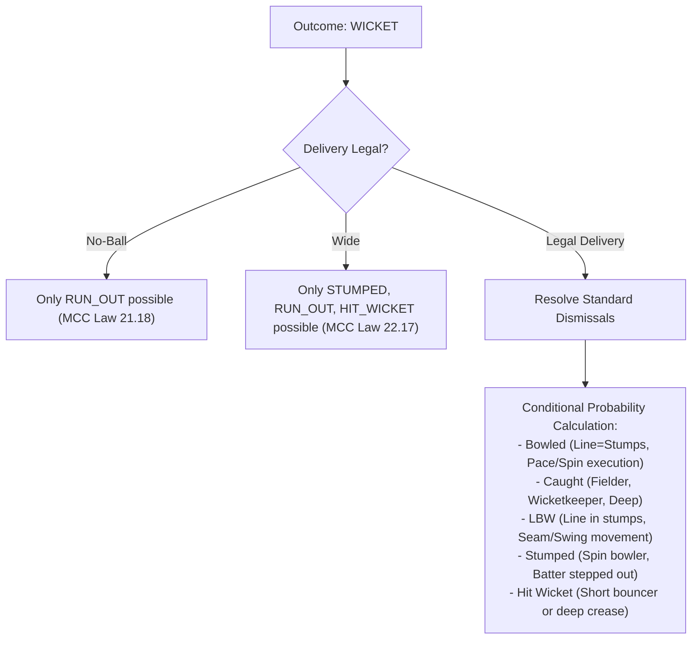

# Cricket Simulation Engine Architecture & Mathematics

**Document Version:** 1.0.0  
**Status:** DRAFT - AWAITING PHASE 0 REVIEW  
**Package:** `@cricket/simulation-engine`  
**Runtime:** Pure TypeScript (Zero external dependencies; Web Worker & Node.js isomorphic)  

---

## 1. Core Architecture & Design Philosophy

The simulation engine is designed as a **purely functional state transition machine**:
$$\text{simulateDelivery}(S_t, A_t, \text{PRNG}_t) \longrightarrow (S_{t+1}, E_t, \text{PRNG}_{t+1})$$

Where:
* $S_t$ is the immutable match state at delivery $t$.
* $A_t$ is the combined tactical action profile (batter intent + bowler intent + field placement).
* $\text{PRNG}_t$ is the deterministic pseudo-random number generator state.
* $S_{t+1}$ is the newly derived immutable match state.
* $E_t$ is the rich delivery event payload (telemetry, trajectory, scorecard delta, commentary).

Under no circumstances does the engine touch external clocks, browser globals, databases, or network calls.

---

## 2. The 10-Stage Delivery Execution Pipeline



### Stage 1: Context Accumulator
Gathers contextual inputs:
- Match format baseline weights (T10, T20, ODI, Test Red Ball, Test Pink Ball).
- Current required run rate vs current run rate ($RRR - CRR$).
- Wickets lost relative to overs elapsed (Innings resource remaining modeled via empirical standard curves; proprietary official DLS software is explicitly excluded from MVP).
- Ball condition: Overs bowled with current ball (0 to 80+).
- Pitch wear index & surface cracks: Deterioration level derived from match day, cumulative deliveries, and pitch composition.
- Batter and bowler current spell fatigue.

### Stage 2: Tactical Intention Resolution
Translates user or AI tactical decisions into operational modifiers:
- **Batter Intent:** `DEFEND`, `ROTATE_STRIKE`, `BALANCED`, `AGGRESSIVE`, `MAXIMUM_POWER`.
- **Bowler Intent:** Line (`OUTSIDE_OFF`, `STUMPS`, `DOWN_LEG`), Length (`YORKER`, `FULL`, `GOOD_LENGTH`, `BACK_OF_LENGTH`, `SHORT`), Variation (`STOCK`, `SLOWER_BALL`, `BOUNCER`, `GOOGLY/ARM_BALL`).
- **Field Preset:** `ATTACKING_CLOSE_CATCHERS`, `BALANCED_RING`, `DEATH_BOUNDARY_DEFENSE`, `SPIN_CHOKE`.

### Stage 3: Attribute Matrix Extraction
Retrieves specific sub-attributes calibrated on a 0–100 scale:
- Batter: Technique, Timing, Power, Strike Rotation, Defensive Ability, Against Pace, Against Spin, Short-Ball Handling, Yorker Handling.
- Bowler: Line & Length, Pace/Spin Execution, Swing/Drift, Seam/Turn, Variation, Yorker Execution, Death Bowling.

### Stage 4: Environmental & Ball Modifiers
Calculates pitch and atmospheric effects:
- **Swing Multiplier ($M_{\text{swing}}$):** Increases with cloud cover ($>60\%$) and humidity ($>70\%$); drops sharply after ball age $> 15$ overs until reverse swing threshold ($> 45$ overs on rough pitch).
- **Seam/Bounce Multiplier ($M_{\text{seam}}, M_{\text{bounce}}$):** Function of pitch type (Green = +35% seam; Hard & Bouncy = +40% bounce).
- **Spin Multiplier ($M_{\text{spin}}$):** Increases dynamically as pitch cracks open (Day 4/5 Test or Dusty pitch = +50% turn).
- **Dew Factor:** Dampens bowler grip in night matches (T20/ODI 2nd innings or Pink Ball 3rd session), increasing boundary probability and wide error rates.

### Stage 5: Batter-Bowler Matchup Resolution
Evaluates direct asymmetrical tactical matchups:
- Left-arm orthodox spinner vs. Left-hand batter (+15% defensive control for batter).
- Off-break spinner vs. Left-hand batter (+20% wicket vulnerability for batter).
- Extreme pace ($>145\text{ km/h}$) vs. low short-ball handling ($<65$) batter (+30% false-shot and caught-behind probability).

---

## 3. Mathematical Formulation of Delivery Probabilities

Let the set of discrete basic delivery outcomes be:
$$\Omega = \{\text{DOT}, \text{RUN\_1}, \text{RUN\_2}, \text{RUN\_3}, \text{FOUR}, \text{SIX}, \text{WIDE}, \text{NO\_BALL}, \text{LEG\_BYE}, \text{BYE}, \text{WICKET}\}$$

For each outcome $k \in \Omega$, we compute the unnormalized log-odds (logit) $z_k$:

$$z_k = \beta_k^{(\text{format})} + \Delta \text{Bat}_k - \Delta \text{Bowl}_k + M_{\text{pitch}, k} + M_{\text{tactics}, k} + M_{\text{matchup}, k} + M_{\text{pressure}, k}$$

Where:
* $\beta_k^{(\text{format})}$ is the empirical format baseline weight (calibrated against real-world cricket datasets).
* $\Delta \text{Bat}_k = \sum_i w_{i, k}^{\text{bat}} \cdot \left(\frac{\text{Attribute}_i - 50}{50}\right)$ measures batter skill deviation from median.
* $\Delta \text{Bowl}_k = \sum_j w_{j, k}^{\text{bowl}} \cdot \left(\frac{\text{Attribute}_j - 50}{50}\right)$ measures bowler skill deviation from median.
* $M_{\text{pitch}, k}$ is the pitch condition scalar for outcome $k$.
* $M_{\text{tactics}, k}$ modifies boundary and wicket probabilities based on chosen aggression level.
* $M_{\text{pressure}, k}$ scales with match situation:
  $$M_{\text{pressure}, \text{WICKET}} = \alpha_{\text{format}} \cdot \max\left(0, \frac{RRR - CRR}{CRR + 1}\right) \cdot \left(1 - \frac{\text{Temperament}_{\text{Pressure}}}{100}\right)$$

### Softmax Normalization
The final probability distribution $P(\text{outcome} = k)$ is obtained via Softmax:
$$P(k) = \frac{\exp(z_k / T)}{\sum_{j \in \Omega} \exp(z_j / T)}$$

Where $T$ is the temperature parameter ($T = 1.0$ by default; slightly elevated in chaotic death overs to capture volatility).

---

## 4. Dismissal Resolution Logic

When an outcome is resolved as $\text{WICKET}$, the exact dismissal mode is determined conditionally:
$$P(\text{DismissalMode} \mid \text{WICKET})$$



### Dismissal Mode Conditional Weights:
1. **Bowled ($P_{\text{bowled}}$):** Favored by full-length deliveries, express pace, reverse swing, or extreme spin breaching inside edge.
2. **Caught Behind / Slips ($P_{\text{caught\_keeper\_slip}}$):** Favored by good length outside off-stump, out-swing, and seam movement.
3. **Caught Outfield ($P_{\text{caught\_deep}}$):** Favored by high batter aggression, lofted shots, and boundaries with long dimensions.
4. **LBW ($P_{\text{lbw}}$):** Requires delivery pitching in-line or outside off, impacting in-line, and hitting stumps (simulated Hawk-Eye tracking).
5. **Stumped ($P_{\text{stumped}}$):** Only available against spin bowling when batter aggression $\ge \text{AGGRESSIVE}$ or miss on flighted ball.

---

## 5. 2D Ball Trajectory & Physics Model

When a ball is struck off the bat, the engine computes a 2D polar vector on the ground plane:
- **Shot Angle ($\theta$):** $\theta \in [0^\circ, 360^\circ)$, where $0^\circ$ is Straight Down the Ground, $90^\circ$ is Cover/Point (for RHB), $180^\circ$ is Fine Leg, $270^\circ$ is Square Leg.
- **Shot Elevation Angle ($\phi$):** $\phi \in [0^\circ, 85^\circ]$.
  - $\phi < 12^\circ$: Ground stroke (cannot be caught in outfield; subject to ground fielding interception).
  - $12^\circ \le \phi \le 35^\circ$: Lofted stroke (power hitting sweet spot; clearing inner circle).
  - $\phi > 35^\circ$: Skied ball / top-edge (high hang time, high catch probability).
- **Shot Distance ($d$):**
  $$d = \left( d_{\text{base}} + 0.6 \cdot \text{Power} + 0.4 \cdot \text{Timing} \right) \cdot \cos(\phi) \cdot M_{\text{wind}}$$

### Fielder Interception & Boundary Resolution
The field is populated with 11 defending positions $(r_i, \theta_i)$.
For any shot $(\theta, d)$, the distance between the ball's trajectory and the nearest fielder $i$ is calculated:
$$\Delta r_i = \|\vec{P}_{\text{ball\_landing}} - \vec{P}_{\text{fielder\_i}}\|$$

If $\Delta r_i \le R_{\text{reach}}$ and $\phi \ge 12^\circ$, a catch evaluation is triggered:
$$P(\text{Catch Taken}) = \frac{\text{Catching}_i}{100} \cdot \left(1 - \frac{\Delta r_i}{R_{\text{reach}}}\right)$$

If $d > \text{BoundaryRadius}(\theta)$, it is a **FOUR** (if $\phi < 25^\circ$ or ball bounced) or **SIX** (if cleared boundary on the full).

---

## 6. Deterministic PRNG, Versioning & Replay Architecture

To guarantee that any simulated match can be perfectly replayed and verified across devices and platforms, we use the **SplitMix64** pseudo-random number generator combined with a versioned state pipeline.

### 6.1 Complete Versioning Triad
A simulation run is strictly governed by three immutable semantic version identifiers:
1. `simulation_version` (e.g. `sim-1.0.0`): The delivery resolution math, PRNG generator, and trajectory model.
2. `ruleset_version` (e.g. `rules-t20-icc-2026.1`): Playing conditions, quotas, field circle restrictions, and tie-breaking logic.
3. `rating_version` (e.g. `rate-1.0.0`): Attribute weights, era normalization baselines, and Bayesian shrinkage dampening parameters.

### 6.2 Initial State Hash ($H_0$) & Monotonic Event Sequencing
Before ball 1 is bowled, an immutable initial state hash $H_0$ is generated:
$$H_0 = \text{SHA-256}\left(\text{JSON.stringify}(\{ \text{seed}, \text{format}, \text{ruleset\_version}, \text{rating\_version}, \text{stadium}, \text{pitch}, \text{lineups} \})\right)$$

Every delivery and user tactical intervention is assigned a monotonically increasing event sequence index $k \in \{1, 2, \dots, N\}$.

### 6.3 Seed Hierarchy & Derivation
To prevent seed corruption and inter-thread state pollution:
$$\text{BallSeed} = \text{Hash64}\left(\text{MatchSeed} \oplus (\text{Innings} \ll 32) \oplus (\text{Over} \ll 16) \oplus \text{Ball}\right)$$

```typescript
// SplitMix64 Deterministic Generator
export class DeterministicPRNG {
  private state: bigint;

  constructor(seed: bigint) {
    this.state = seed;
  }

  public nextFloat(): number {
    this.state += 0x9e3779b97f4a7c15n;
    let z = this.state;
    z = (z ^ (z >> 30n)) * 0xbf58476d1ce4e5b9n;
    z = (z ^ (z >> 27n)) * 0x94d049bb133111ebn;
    z = z ^ (z >> 31n);
    return Number(z & 0xfffffffffffffn) / 0x10000000000000;
  }
}
```

### 6.4 Replay Verification vs. Anti-Cheat Boundary
- **Verification Guarantee:** 
  $$\text{ReplayVerify}(H_0, \text{MatchSeed}, \text{ActionLog}, \text{SimVersion}, \text{RulesetVersion}) \equiv S_{\text{recorded}}$$
  Feeding the recorded actions back into the engine reproduces the exact ball-by-ball trajectory, scorecard, and final state.
- **Critical Distinction:** *Seed-based reproducibility alone does NOT constitute client-side cheat prevention.* In single-player mode, local execution allows zero-latency play and state auditability. To certify official records or competitive results, the backend server re-simulates the action log independently using the authoritative server engine before certifying the scorecard.

---

## 7. Match State Machine & Multi-Format Invariants

The underlying domain state natively accommodates both Limited Overs and Multi-Day Test cricket (T10, T20, ODI, Test Red Ball, Test Pink Ball) without architectural refactoring.

```typescript
export interface MatchState {
  readonly matchId: string;
  readonly format: 'T10' | 'T20' | 'ODI' | 'TEST_RED_BALL' | 'TEST_PINK_BALL';
  readonly seed: bigint;
  readonly simulationVersion: string;
  readonly rulesetVersion: string;
  readonly ratingVersion: string;
  readonly initialStateHash: string;
  readonly status: 'SCHEDULED' | 'IN_PROGRESS' | 'INNINGS_BREAK' | 'STUMPS' | 'COMPLETED';
  
  // Multi-Innings & Multi-Day Structure
  readonly currentInningsIndex: number; // 0 to 3 (Innings 1 to 4)
  readonly innings: readonly InningsState[];
  readonly currentDayNumber: number; // 1 to 5 (Test)
  readonly currentSessionNumber: number; // 1: Morning, 2: Afternoon, 3: Evening/Night
  readonly oversRemainingToday: number; // Scheduled 90 overs per day in Test
  
  // Environmental & Pitch Deterioration Tracking
  readonly pitchWearIndex: number; // 0.0 (pristine) to 1.0 (heavily degraded)
  readonly surfaceCracksIndex: number; // 0.0 to 1.0 (amplifies spin & uneven bounce)
  readonly ballCondition: number; // 0.0 (brand new) to 1.0 (soft/rough)
  readonly followOnEnforced: boolean;
}

export interface InningsState {
  readonly inningsNumber: number; // 1, 2, 3, or 4
  readonly battingTeamId: string;
  readonly bowlingTeamId: string;
  readonly totalRuns: number;
  readonly totalWickets: number;
  readonly completedOvers: number;
  readonly legalBallsInCurrentOver: number;
  readonly strikerPlayerId: string;
  readonly nonStrikerPlayerId: string;
  readonly currentBowlerPlayerId: string;
  readonly overs: readonly OverState[];
  readonly fallOfWickets: readonly FallOfWicket[];
  
  // Innings Flow Controls
  readonly targetRuns?: number; // Present in chasing innings
  readonly leadOrDeficit: number; // Cumulative run differential
  readonly isFollowOn: boolean;
  readonly isDeclared: boolean; // Test cricket declaration
  readonly isCompleted: boolean;
}
```

### Core Invariants Enforced on Every State Mutation:
1. **Runs Invariant:** $\text{TotalRuns} = \sum \text{BatRuns} + \text{Wides} + \text{NoBalls} + \text{Byes} + \text{LegByes} + \text{Penalties}$.
2. **Wickets Invariant:** $\text{TotalWickets} \le 10$ (except when special innings concession/retirement rules apply).
3. **Over Invariant:** $\text{LegalBallsInCurrentOver} \le 6$; an over ends if and only if 6 legal deliveries have been bowled.
4. **Striker Rotation Invariant:** 
   - Strikers switch on odd runs scored off the bat or odd byes/leg-byes.
   - Strikers switch at the end of each completed over (unless an intervening wicket dismissed non-striker).
   - Strikers do NOT switch on even runs or standard dot balls.
5. **Bowler Quota Invariant:** No bowler may exceed the ruleset quota:
   - T10: $\le 2$ overs.
   - T20: $\le 4$ overs.
   - ODI: $\le 10$ overs.
   - Test: Unlimited quota; consecutive overs from both ends are forbidden (MCC Law 21.7).
6. **Follow-On Invariant:** Follow-on can only be enforced in 5-day Test matches if the 1st innings deficit is $\ge 200$ runs.
7. **Declaration Invariant:** An innings may only be declared closed between deliveries or at a session stoppage.
8. **Test Match Outcome Invariant:**
   - **Win:** Chasing team surpasses target in 4th innings, or bowling team dismisses chasing team before target is reached.
   - **Draw:** Scheduled 5 days / overs expire without 4th innings concluding.
   - **Tie:** 4th innings team is all out with scores exactly level.
