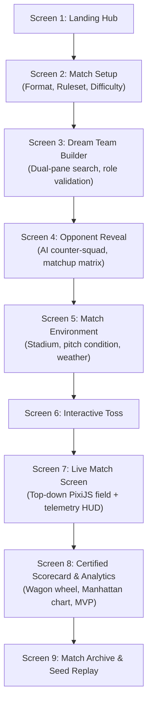

# UI/UX Guidelines & Design System

**Document Version:** 1.0.0  
**Status:** DRAFT - AWAITING PHASE 0 REVIEW  
**Design Philosophy:** Editorial Minimalism & High-Fidelity Sports Telemetry  
**Primary CSS Framework:** Tailwind CSS v4  

---

## 1. Aesthetic Direction: Editorial Sports Prestige

The visual identity rejects generic flashy esports aesthetics, neon gradients, and cartoonish skeuomorphism. Instead, it adopts an **editorial sports journalism aesthetic** reminiscent of *Wisden Cricketers' Almanack*, *The Financial Times*, and *Monocle*, fused with precision telemetry.

```text
Visual Pillars:
1. Editorial Typography: Prestigious serif titles paired with mono-spaced numeric clarity.
2. Controlled Palette: Grounded deep emeralds, rich charcoals, warm trophy gold, and crisp chalk white.
3. Restrained Glass & Elevation: Flat matte surfaces with 1px hairline borders; frosted glass used solely for HUD overlays.
4. Functional Motion: Purposeful transitions (spring physics for scoreboard updates; zero gratuitous idle loops).
```

---

## 2. Design System Tokens

### 2.1 Color Palette
* **Canvas Primary:** `#0E1013` (Deep Obsidian Charcoal)
* **Surface Card:** `#181B20` (Matte Slate)
* **Surface Elevated:** `#22262E` (Secondary Slate)
* **Border Hairline:** `#2E3440` (Subtle 1px border)
* **Pitch Emerald:** `#0D4A38` (Traditional Grass Green)
* **Accent Gold:** `#D4AF37` (Trophy & Captaincy Accent)
* **Text High-Contrast:** `#F8F9FA` (Chalk White)
* **Text Muted:** `#9CA3AF` (Refined Silver Grey)
* **Cricket Red:** `#C92A2A` (Wickets, Test Red Ball, Danger State)
* **Pink Ball Violet:** `#E64980` (D/N Test Accent)

### 2.2 Typography Hierarchy
* **Display / Editorial Headings:** `Cinzel` or `Playfair Display` (Serif). Conveys history, tradition, and prestige.
* **Interface & Body:** `Inter` or `Geist Sans`. Maximum legibility across small mobile displays.
* **Telemetry & Numeric Scoreboards:** `JetBrains Mono`. Monospaced numbers prevent jitter during rapid real-time updates.

---

## 3. Screen-by-Screen UX Architecture



### Screen 3: Dream Team Builder (Dual-Pane Layout)
* **Left Pane (55% width):** Global Player Browser. Instant fuzzy search, format filter chips (T20/Test/ODI), nationality dropdown, historical era slider, and sorting by composite ratings.
* **Right Pane (45% width):** Active Playing XI Sheet.
  - Interactive batting order drag-and-drop slots (1 to 11).
  - Captain (`(C)`), Vice-Captain (`(VC)`), and Wicketkeeper (`(WK)`) badges.
  - **Live Validation Banner:** Real-time feedback bar highlighting missing requirements (e.g. *"Needs designated keeper"*, *"At least 5 bowling options required"*).
  - **Squad Radar Matrix:** Visual polygon charting Batting Depth, Pace Threat, Spin Threat, Fielding Agility, and Balance.

### Screen 7: Live Match Screen (Central Viewport)
A high-density, unified command center split into three synchronized functional zones:

```text
+-------------------------------------------------------------------------------+
| LIVE BROADCAST SCOREBOARD (Top Banner)                                        |
| IND: 142/3 (16.2 ov) | CRR: 8.70 | Target: 185 | RRR: 11.72 | P3 Powerplay    |
| Striker: V. Kohli 64*(42) [4s: 6, 6s: 2] | Bowler: P. Cummins 3.2-0-28-1      |
+---------------------------------------+---------------------------------------+
| PIXIJS 2D TOP-DOWN FIELD CANVAS       | STRATEGIC TELEMETRY CONSOLE           |
| (60 FPS Vector / Sprite View)         |                                       |
| - Boundary rope & 30-yd ring          | [Hybrid Mode Switch: Ball | Phase]    |
| - Dynamic 11 fielder node positions   |                                       |
| - Animated ball release & trajectory  | Batter Tactical Intent:               |
| - Real-time wagon wheel arc overlay   | [ Defend | Rotate | Attack | Smash ]  |
| - Pitch landing zone marker           |                                       |
|                                       | Bowler Line & Length Controls         |
|                                       | Field Placement Presets Dropdown      |
|                                       |                                       |
|                                       | Commentary & Ball-by-Ball Feed:       |
|                                       | "16.2 Cummins to Kohli: FOUR! Struck  |
|                                       |  crisply through extra cover."        |
+---------------------------------------+---------------------------------------+
```

---

## 4. PixiJS 2D Field Rendering Engine Design

The 2D visualizer renders on an HTML5 WebGL/WebGPU canvas managed via PixiJS v8.

### Coordinates and Scaling:
* Coordinate Origin $(0, 0)$ is set at the center of the pitch.
* Field is mapped in normalized meters:
  - Stumps to Stumps: $20.12\text{ m}$.
  - Inner 30-yard Circle: Radius $R = 27.43\text{ m}$.
  - Boundary Rope: Configured per stadium ($60\text{ m}$ to $85\text{ m}$).
* **Camera Viewports:**
  - `CLASSIC_TOP_DOWN`: Full circular ground overview.
  - `BATTER_PERSPECTIVE`: Angled perspective looking from behind the bowler's arm toward striker.

### Trajectory Physics & Animation:
1. **Delivery Release:** The ball sprite scales and moves from bowler's release point to pitch landing coordinates $(x_{\text{pitch}}, y_{\text{pitch}})$.
2. **Pitch Bounce:** Velocity vector reflects with friction dampening based on pitch surface rating.
3. **Bat Impact:** Ball velocity instantly accelerates toward shot angle $\theta$ and distance $d$.
4. **Fielder Interpolation:** The nearest defending fielder sprite slides smoothly across the green canvas along an intercept vector.
5. **Boundary Celebration:** When a four or six is scored, a clean gold or crimson perimeter pulse animates along the boundary rope.

---

## 5. Responsive Multi-Device Adaptations

| Device Class | Viewport Width | Layout Strategy |
|---|---|---|
| **Desktop Ultra/Wide** | $\ge 1440\text{ px}$ | 3-Column Command Layout: (Left: Scoreboard/Lineups, Center: Field Canvas, Right: Tactical Controls & Commentary). |
| **Laptop / Desktop** | $1024\text{ px} - 1439\text{ px}$ | 2-Column Split: Field canvas dominant on left (60%), collapsible tactical telemetry drawer on right (40%). |
| **Tablet** | $768\text{ px} - 1023\text{ px}$ | Vertical Stack: Fixed header scoreboard, central square field canvas, tabbed swipe panels for tactics and commentary. |
| **Mobile** | $< 768\text{ px}$ (down to $375\text{ px}$) | Single-Column Mobile Mode: Sticky compact scoreboard bar at top; touch-optimized tap-to-expand field view; bottom action sheet for shot selection. |
